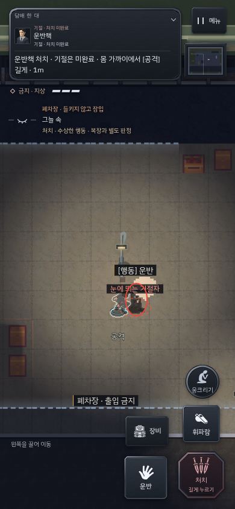
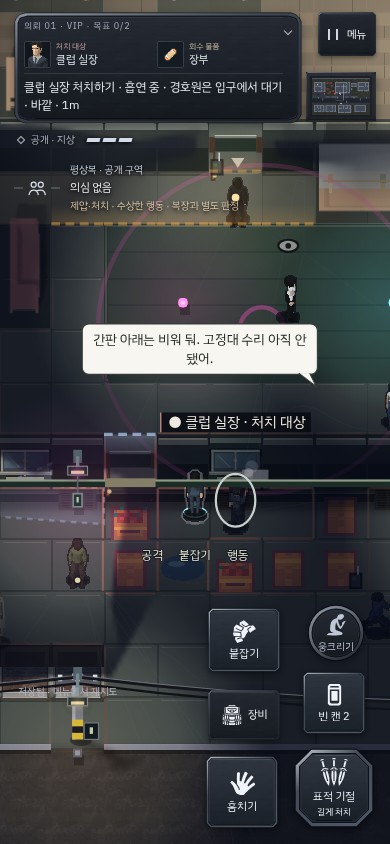

# v176 · 문 판정과 이동, 목격 표시

v175를 실제 조작해 확인한 문제 세 가지를 수정했다. 첫 의뢰에서 VIP까지 이어서 진행하면 웅크림이 남았고, 전봇대에 자동으로 붙어 이동이 끊겼다. 문 닫기는 다른 층이나 옥상의 NPC까지 장애물로 계산했다. 현장 표시의 ‘봤다’와 ‘마지막 목격 지점’은 시체 발견·소리·플레이어 목격을 구별하기 어려웠다.

문은 같은 층과 높이에 실제로 있는 사람·시체·기절자만 확인한다. 운반·은닉한 몸과 비활성 NPC는 문을 막지 않는다. 닫지 못할 때는 경비가 통과 중인지, 시체나 기절자를 옮겨야 하는지 안내한다. 문 접촉 동작과 실제 장애물, 수색 경비의 문 돌파 규칙은 유지한다.

새 의뢰와 재시도는 서서 시작한다. 항상 걷기 설정은 유지하며, 일시정지와 체크포인트에서는 저장한 자세를 복원한다. 전봇대는 충돌하지만 엄폐 대상에서 제외했다. 웅크려 실제 벽을 밀어 기대기, 벽을 따라 조용히 움직이기, 반대 방향으로 나오기는 그대로다. 시야 판정이나 은폐 배율을 낮추지 않았다.

현장 표시는 이미 일어난 AI 사건을 읽는다. 쓰러진 사람 발견, 소리 조사, 이상 흔적 조사, 신원이 확인되지 않은 사람 목격, 내 모습 목격, CCTV 목격과 제보를 구분한다. 시체 보고에 플레이어의 위치나 신원을 새로 부여하지 않는다. 새로운 흔적을 조사할 때 이전 목격 사유가 남지 않게 했고, 수색 중 새로 사람을 보면 이전 시체 현장 대신 새 관찰을 표시한다. 기절한 몸은 ‘눈에 띄는 기절자’로 표시한다.

공개 구역에서 주변 수색이 진행되는 동안은 실제로 시야 밖인지, 허용된 통행을 하고 있는지 표시한다. 카메라 전선을 끊었을 때도 녹화가 남아 있는 경우에만 관리실 삭제를 안내한다.

검증:

- 핵심 회귀 **73개 모두 통과**. 빌드 파이프라인 7검사, 스프라이트 소유권, 도달 검사 포함. [실행 기록](clarity-v176/core.txt)
- [새 규칙 검사](clarity-v176/rules.json): PC와 모바일 3크기에서 실제 지연된 문 조작, 층·옥상·운반/은닉 구분, 저장 복원, 자세 초기화, 전봇대/벽 이동, 캔버스의 기절자 표시, 실제 시체 검사·보고·신원 지식 구분을 확인했다. 좌표와 상태를 준비하는 통제된 회귀 검사다.
- [일반 시간의 연속 플레이](clarity-v176/campaign.json): 엔진 API·고정 시계·시드를 사용하지 않고 키보드/터치로 첫 의뢰를 완료하고, 같은 저장에서 VIP로 넘어가 서 있는 상태로 실장을 관찰했다. PC·모바일 첫 의뢰 발각 0회. 장면 확인 사이에는 게임 메뉴로 일시정지했다.
- [VIP 전체 경로](clarity-v176/vip-native.json): 일반 RAF·비고정 난수에서 PC와 모바일 각각 기술 없이 체력 3·발각 0회로 탈출했다. 시체 발견과 경보는 각 1회였다. 경로 도우미는 좌표와 순찰/문 상태를 읽으며, 실제 입력으로 조작하고 배우·체력·인벤토리·진행을 바꾸지 않는다.
- 기존 엄폐 회귀의 ‘밝은 곳 150px에서 완전히 안 보여야 한다’는 기대는 v175 배포본에서도 실패했다. 실제 시야 감쇠량을 비교하도록 보완하고 VIP의 실제 지상 벽을 명시해 재검사했다. 엄폐·웅크림·서기 순서의 노출 감소와 조용한 옆걸음, 해제를 확인했다. [엄폐 검사](clarity-v176/cover.txt)

알고 있는 맵 경로를 이용한 개발자 플레이와 규칙 검사다. 초보자의 학습 시간이나 장기 재미, 구매 의사를 입증하는 사용자 연구로 해석하지 않는다.

