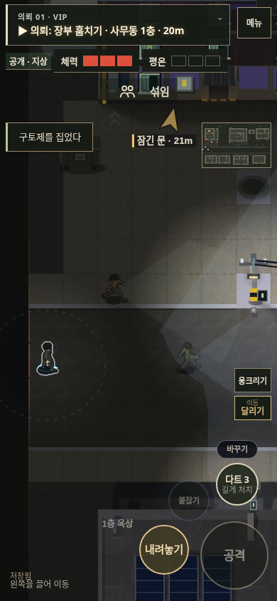
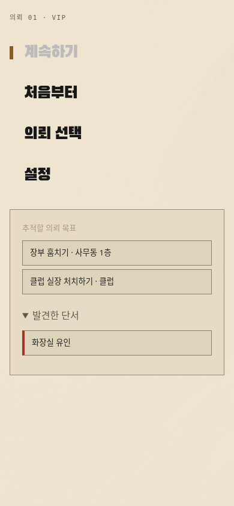

# v119 — 목적은 의뢰가 정하고, 방법과 순서는 플레이어가 정한다

약·비밀번호·변장·전화 유인은 접근 방법을 늘리는 수단이다. 기다렸다가 직접 암살하거나, 표적부터 처리한 뒤 물품을 회수해도 된다. 단서를 따라가지 않았다는 이유로 의뢰를 실패시키거나 필수 단계를 추가하지 않는다.

## 적용

- 약을 줍거나 사용하기, 옥상 접근, 장부 회수, 전화 호출로 상단 의뢰 목표가 자동 교체되지 않는다. 현재 고른 목표는 완료하거나 직접 바꿀 때까지 유지한다.
- 발견한 단서는 메뉴의 접힌 목록에 남긴다. PC의 기존 T 키 또는 메뉴에서 직접 고른 단서만 추적한다. 단서 버튼을 다시 누르거나 의뢰 목표를 고르면 추적을 끝낸다. 모바일도 같은 메뉴를 사용한다.
- 단서 안내를 ‘전체’로 설정해도 자동으로 공략을 선택하지 않는다. 기존 저장 파일의 자동 추적 값도 목적 안내를 덮어쓰지 않는다. 직접 선택한 추적은 저장·복원한다.
- 전화 호출이 플레이어의 목표 선택을 초기화하지 않는다. 거래 약속을 놓쳐도 기존 의뢰를 계속할 수 있다.
- 놓친 구토제 유인 기회는 안내를 접는다. 지나간 화장실 기회를 계속 가리키지 않는다.
- 감방 첫 안내는 ‘감방에서 나가기’만 표시한다. 머리핀 위치를 의무적인 경유지로 표시하지 않는다.

완료 조건은 기존 의뢰의 표적·회수품, 실제 신원이 녹화됐을 때 필요한 기록 삭제, 탈출이다. 연습 임무의 단계 안내는 유지한다.

## 확인한 범위

| 확인 | 결과 및 한계 |
| --- | --- |
| 6개 미션 × 3개 물품 배치 × PC·모바일 입력 | 기본 진행 36경로 완료. 이동·문 열기·회수·길게 눌러 처치·탈출을 실제 입력으로 실행. NPC 시뮬레이션은 진행 검사에서 정지. 비밀번호는 맵 자료를 알고 입력하므로 초심자 발견성 평가는 아님. |
| 6개 미션 × PC·모바일 입력, 표적 우선 | 추가 12경로 완료. 의뢰 물품보다 표적을 먼저 처리해도 완료 조건 일치. 같은 NPC 정지 조건 적용. |
| 준비 없는 기다리기 | 통상 숨기 동작으로 진입한 뒤 전체 AI·카메라를 180초 진행. 체력 3 유지, 강제 실패·목표 변경 없음. 실장 이동 거리 2,075px, 일과의 3개 지점 방문. 숨기 시작 위치만 통제한 규칙 검사. |
| 전화 매복 | 3개 배치 × PC·모바일 6경로. 실장과 호위의 실제 이동, 사물함 대기·나오기·처치·탈출 확인. 다른 NPC는 정지. |
| 식당 유인·비살상 변장 | 경비 일과를 실행한 6경로 및 전체 AI·카메라가 활성화된 PC·모바일 2경로. 처치 0, 경비복으로 사무동 진입. |
| 안내·저장·조작 | 준비 후 목표 유지, 옛 저장 파일, 직접 고른 단서 복원, 추적 해제, 놓친 약속·유인 기회, PC·모바일 메뉴 입력·키보드 초점 확인. |
| 기존 조작·첫 시작 | 조작 표시 8개 화면 조합, PC·모바일 연습→첫 의뢰, 조기 탈출 방지, 저장 복원 통과. |

자동화와 통제된 장면 검사 결과다. 전 미션을 처음 접하는 사람이 직접 플레이한 사용성 평가로 보지는 않는다. 이번 변경의 초점은 플레이 방식의 자유와 그에 맞는 안내다.

검증 스크립트: `t_free_approach.py`, `t_patient_wait.py`, `t_mission_flow.py`, `t_rendezvous.py`, `t_rendezvous_walkthrough.py`, `t_uniform_walkthrough.py`, `t_product_plan.py`, `t_first_session.py`, `t_controls_readability.py` (`tests/rev/`).

## 적용 화면

약을 들고 있어도 상단에는 의뢰 목적을 유지한다. 단서를 따라가고 싶을 때만 메뉴에서 선택한다.

[PC 의뢰 목적](free-approach-v119/pc-required-goal.png) · [PC 단서 선택](free-approach-v119/pc-clue-menu.png)
