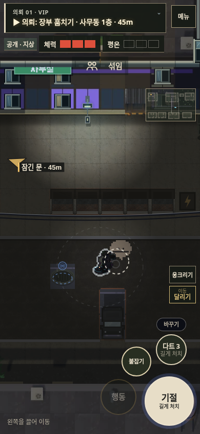

# v119 손맛 점검

평가 대상: 소스 `598d1524a0f8777d69783e7089a5545b684be996`의 로컬 빌드.

기본 반응은 있다. 다만 제압하는 순간의 화면·판정·소리가 어긋나고, 다음 입력을 놓치는 구간이 있어 ‘내가 잡고 제압했다’는 감각은 부족하다. 화면 흔들림을 크게 만드는 것보다 이 연결을 먼저 고쳐야 한다.

## 확인 방법

PC 키보드와 390×844 터치 브라우저의 포인터 입력을 재현했다. 같은 거리 30px의 적을 둔 통제 장면에서 입력 직후, 0.1·0.3·0.6·1.0·1.3초의 상태와 화면을 기록했다. 이 타이밍 검사는 다른 NPC·카메라를 끄고 수행했다. 게임 소스는 바꾸지 않고, 브라우저에 제공한 검사본에 소리 호출 기록만 추가했다.

소리 재생 함수 호출 시점과 애니메이션 상태를 측정한 결과다. 실제 휴대폰의 터치 지연·진동·스피커 음질이나 사람이 느끼는 쾌감을 수치로 측정한 결과는 아니다.

[입력·상태·소리 기록](game-feel-v119/timing.json)

## 우선 개선할 부분

### 1. 붙잡기에서 다음 동작으로 넘어갈 때 입력이 사라진다

가까운 적을 붙잡는 데 약 **0.373초**가 걸렸다. 시작 후 **0.2초**에 공격을 한 번 누르면 입력이 저장되지 않는다. 0.8초까지 진행해도 살아 있는 적을 붙잡은 상태로 남고, 다시 공격을 눌러야 제압한다. PC·모바일 입력에서 동일했다.

플레이어에게는 이미 손으로 잡은 모습인데 조작이 안 먹은 것으로 보일 수 있다. `actAttack`, `actEnv`, `actGrab` 모두 동작 중이면 바로 반환한다. 접근 중 공격 예약은 있지만, 동작 끝의 다음 입력 예약과는 다르다.

**개선안:** 동작 마지막 약 0.2초에 입력한 다음 행동을 한 번만 예약한다. 처음 선택한 대상과 행동을 유지하며, 대상·거리·층을 다시 검사한다. 취소되거나 대상이 사라지면 예약도 버린다. 새로운 적을 자동으로 공격하거나 짧게 누른 입력이 처치로 바뀌면 안 된다.

근거: [79_buttons.js](../src/js/79_buttons.js), [60_interact.js](../src/js/60_interact.js)의 `grab`, `updateGrabIn`.

### 2. 제압을 시작하자마자 결과와 충격음이 먼저 나온다

뒤에서 짧게 공격하면 **입력 직후 0초에 이미 기절 상태·기절 시체·충격음이 생긴다.** 화면의 목 조르기 동작은 이후 **1.15초** 동안 이어진다. 시체는 그동안 숨겨 두지만, 판정과 결과 안내는 먼저 발생한다.

예약된 바닥 충돌음도 실제 애니메이션 진행이 아닌 `setTimeout` 시간을 사용한다. 붙잡은 적의 제압 직후 메뉴를 열어 게임 시간이 멈춰 있는 상태에서도, 약 **0.75초 뒤** 충돌음 재생 함수와 흔들림 예약이 실행되는 것을 확인했다. 정지·느려짐과 동작의 시간이 어긋나는 재현 가능한 문제다.

**개선안:** ‘손 닿음 → 제압 성립 → 몸 내려놓기’를 동작 안의 사건으로 나눈다. 판정·효과음·작은 적 반응을 해당 순간에 함께 실행하고, 완료 안내도 결과가 성립할 때 낸다. 조용한 제압과 강한 충돌은 반응 크기를 다르게 한다. 처치의 **같은 버튼 1초 길게 누르기** 규칙은 유지한다.

근거: `strikeKill`, `pairKill`, `koPerson`, `execCaptive` — [60_interact.js](../src/js/60_interact.js).

### 3. 접촉 순간의 강조가 동작마다 다르다

붙잡기에는 손이 닿을 때 접촉 효과와 소리가 있지만, 일반 기절 공격에서는 같은 접촉 표시가 생기지 않았다. 공격 시작의 0.07초 타격 정지는 존재하므로 효과가 아예 없는 것은 아니다. 다만 ‘언제 힘이 실리는가’를 동작과 함께 맞출 필요가 있다.

**개선안:** 붙잡기는 손과 어깨의 짧은 반동·옷 마찰음, 제압은 적의 힘이 풀리는 순간, 바닥 충돌은 착지 순간을 강조한다. 기존 애니메이션의 타이밍·위치·효과음을 먼저 조정한다. 모든 행동에 같은 화면 흔들림을 추가할 필요는 없다.

근거: `contactFeedback`, `drawContactFeedback` — [77_play_clarity.js](../src/js/77_play_clarity.js), 타격 정지 처리 — [85_loop.js](../src/js/85_loop.js).

### 4. 모바일에서는 손과 상대의 반응이 작고 겹친다

390px 화면에서 접촉 순간과 0.6초·1.0초 장면을 비교하면 두 사람이 겹친 모습과 흰 외곽선이 손·상체 동작보다 먼저 눈에 들어온다. 입력이 반응해도 무슨 동작이 진행되는지 읽는 힘이 약하다.

**개선안:** 플레이어 식별 표시는 유지하면서, 두 사람 동작 중 손·목·어깨가 묻히지 않도록 외곽선의 두께와 겹침을 조절한다. 붙잡힌 적의 상체 반응과 중심 이동을 조금 더 명확하게 한다. 카메라·기존 버튼 위치를 바꾸는 작업보다 먼저 한다.

| 입력 직후 | 0.6초 | 1.0초 |
| --- | --- | --- |
|  |  |  |

## 유지할 부분

- 짧게 기절 / 같은 버튼을 길게 눌러 처치하는 구분은 일관적이다. 이 규칙을 없애거나 처치 확인 시간을 무작정 줄이지 않는다.
- 이동에는 이미 짧은 가속·감속과 모서리 미끄러짐 처리가 있다. ‘무게감’을 위해 관성을 더 늘리면 잠입 조작이 둔해질 수 있다.
- 문·옷 갈아입기·수납·환풍구는 접근 검증과 동작 잠금이 있어 중복 입력으로 중간 단계를 건너뛰지 않게 되어 있다. 이 안전장치를 유지하면서 다음 입력만 연결한다.
- 진입 위치·진행 순서를 플레이어가 고르는 v119의 방향과 손맛 개선은 함께 갈 수 있다. 강제 연출이나 공략 단계를 추가할 필요는 없다.

## 권장 작업 순서와 합격 기준

1. **판정·효과음의 순간 통일:** 일시정지 중 예약 충돌음이 새로 발생하지 않고, 느려진 화면에서도 손 접촉·제압·착지와 소리가 함께 진행된다.
2. **다음 입력 연결:** 붙잡기 마지막 0.2초의 공격 입력을 한 번만 실행한다. 반복 처치·다른 적 공격·길게 누르기 우회가 없어야 한다.
3. **모바일 자세 가독성:** 텍스트를 읽지 않아도 붙잡음·기절·처치·들고 있음을 구별할 수 있다. 플레이어 식별력도 유지한다.
4. **동작별 작은 반응 조정:** 조용한 제압과 강한 충돌의 반동·소리 차이를 먼저 만든다. 이후에 흔들림이나 진동을 보조로 검토한다.

수치는 개선 목표이며 적용된 변경값은 아니다. 이번 점검에서 게임 동작은 수정하지 않았다.

관련 회귀 검사도 통과했다: `tests/rev/t_combat_policy.py`의 짧게/길게 누르기·붙잡기·모바일 입력, `tests/rev/t_interaction_flow.py`의 상호작용 연속성·중복 입력 방지·15개 환풍구 왕복. 기능이 정상 완료되는 것과 손맛이 좋다는 평가는 별개다.
