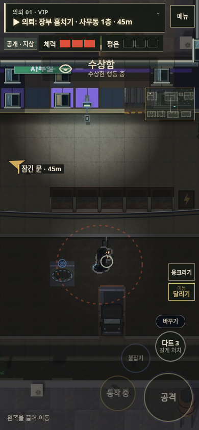
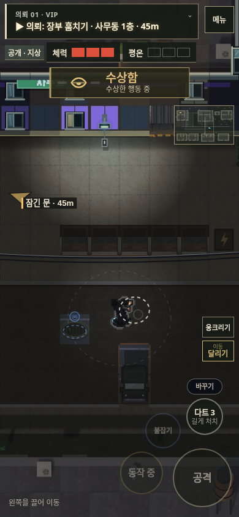
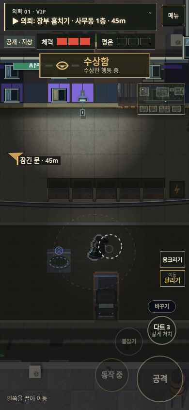

# v120 — 제압 동작과 입력 연결 개선

붙잡기를 마치기 직전에 누른 공격이 사라지고, 손이 닿기 전에 기절 판정·충격음이 발생하던 부분을 수정했다. [v119 점검](GAME_FEEL_REVIEW_V119.md)의 입력·동작 시간 측정을 바탕으로 한 변경이다.

## 달라진 동작

- 제압 시작에는 적을 동작에 묶어 둔다. 손이 닿고 힘이 풀리는 단계에서 기절 판정·안내를 내고, 몸을 내려놓을 때 바닥 충돌음을 낸다. 처음부터 결과를 표시하지 않는다.
- 접촉·제압·착지 효과음은 애니메이션과 같은 게임 시간을 쓴다. 일시정지나 느려짐에서도 동작과 소리가 함께 진행한다. 일반 처치의 짧은 후속 충돌음도 게임 시간으로 옮겼다.
- 붙잡기 마지막 0.2초에 누른 공격을 같은 적에게 한 번만 이어서 실행한다. 다른 적으로 바뀌거나 층이 달라지면 실행하지 않는다. 메뉴·창 전환은 예약을 취소한다.
- 짧게 눌러 기절 / 같은 버튼을 계속 눌러 처치하는 구분은 유지한다. 기절 판정이 늦어진 만큼 처치 확인 시간이 추가로 늘어나지 않도록 했다. 예약한 공격도 실행 후 최소 1초의 연속 입력이 필요하다.
- 모바일에서 두 사람 동작 중 흰 외곽선을 줄이고 파란 발밑 식별 표시는 유지한다. 동작 중인 적을 따로 중복해서 그리지 않는다. 제압 중인 적의 시야 표시와 몸을 내려놓기 전 기절 아이콘도 숨겨 손·상체 동작을 가리지 않게 했다.

버튼 위치·새로운 선택 메뉴·강제 연출은 추가하지 않았다.

## 측정과 검증

통제된 같은 장면에서 PC 키보드와 Chrome 터치 이벤트를 검사했다. 일반 제압의 게임 시간 기록은 접촉 0.15초, 기절 0.55초, 착지 0.95초였다. 브라우저 프레임 처리에 따른 경계 오차가 있어 설계 기준인 0.14·0.54·0.943초보다 한 틱 늦게 기록된다.

| 검사 | 결과 |
| --- | --- |
| 접촉 전 결과 없음 → 기절 → 착지 | 판정과 효과음이 각 단계에서 한 번씩 발생 |
| 길게 누르기·떼었다 다시 누르기 | 1초 전 처치 없음, 별도 입력이 이전 처치 의도를 이어받지 않음 |
| 붙잡기 끝의 다음 공격 | PC·실제 브라우저 터치 이벤트 모두 한 번 실행, 짧게 누르면 기절 |
| 메뉴·대상 사망·층 변경 | 예약 취소 또는 해당 동작 취소, 다른 적 자동 공격 없음 |
| 일시정지 1.15초 | 게임 시간과 효과음 호출 수 모두 정지, 재개 후 착지음 한 번 |
| 제압 도중 체크포인트 복원 | 같은 적·동작 단계 유지, 저장된 누름 상태로 처치되지 않음 |
| 렌더링 | 몸을 내려놓기 전 기절 아이콘 없음, 조기 표시가 접촉 자세를 가리지 않음 |
| 6개 의뢰 × 3개 배치 × PC·모바일 입력 | 36개 진행 경로 완료. 이동·문·물품·처치·탈출 검사에서는 NPC 시뮬레이션을 정지함 |
| 전화 매복 6경로 | 표적·호위의 실제 이동, 숨기·나오기·처치·탈출 통과. 다른 NPC는 정지함 |
| 기존 조작·정책 | 짧게/길게 누르기, 기절 표적의 미완료 판정, 자유로운 목표 안내, 8개 조작 화면 조합, 15개 환풍구 왕복 등 통과 |

식당 경비 유인·비살상 변장 경로는 경비 일과를 실행한 6경로와 별도 전체 AI·카메라 활성 PC·모바일 재현에서 통과했다. 초기 전체 경로 묶음의 한 실행에서는 제압 전에 경비의 화장실 이동이 막혔다. 동일 시드로 새 브라우저에서 각각 재현했을 때는 두 입력 방식 모두 0처치로 사무동에 진입했다. 이 군중 동선의 변동은 별도 점검 여지로 남긴다.

실제 휴대폰의 지연·진동·스피커 청감이나 사람이 느끼는 손맛의 향상 폭을 측정한 검사는 아니다. 이번 검증은 동작·판정·입력·소리 호출의 연결을 확인한다.

재현: `tests/rev/t_combat_feel.py`. [이벤트 시간 기록](game-feel-v120/timing.json)

## 적용 화면

| 손 접촉 | 기절 | 몸 내려놓기 |
| --- | --- | --- |
|  |  |  |

[PC 접촉](game-feel-v120/pc-contact.png) · [PC 기절](game-feel-v120/pc-down.png) · [PC 착지](game-feel-v120/pc-landing.png)
