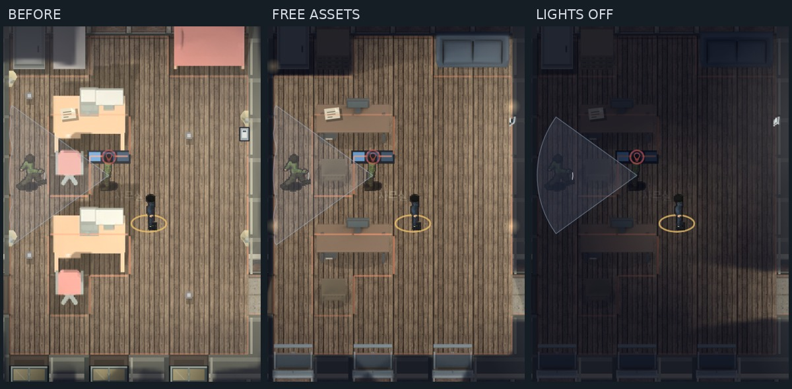

# 무료 에셋 실내 시범 — v201

VIP 의뢰(`m2`)의 **사무동 2층 사무실 한 방**에 적용했다. 기존 주인공·2D 카메라·미션 구조를 유지하며, 분홍 가구 대신 청회색 소파·의자와 나무 책상을 배치했다. 전체 맵 교체나 엔진 전환은 아니다. 유료 구매는 없다.

## 제작과 적용

- Quaternius Ultimate House Interior의 의자·소파·서랍장, Poly Haven Industrial Wall Lamp(Kuutti Siitonen): **CC0**.
- 스위치·미닫이 창문·나무 책상은 직접 모델링했다. 원본과 검증 해시·라이선스는 `tools/prerender/room_finish_src/`에 보관한다.
- Blender에서 기존 캐릭터와 같은 높이 투영 원리로 렌더링했다. 게임에는 모델 대신 **2D WebP 48장, 약 119KB**가 추가된다. Blender·3D 런타임은 배포하지 않는다.
- 방의 기본 가구 배치·충돌 칸을 유지한다. 부드러운 접지 그림자와 기존 조명 마스크를 함께 받는다.
- 스위치를 실제 벽에 붙이고, 같은 방의 등 4개를 한 회로로 제어한다. 기본 소등에 기술은 필요 없다. 기존 주민·경비의 스위치 확인 반응을 유지한다.
- 등 그림과 실제 광원을 같은 벽 위치로 옮겼다. 조명 범위는 240→300px로 조정해 켜진 사무실의 작업 공간 밝기를 유지했다. 벽 가림 다각형과 색 번짐을 함께 제한한다.
- 사무실의 미닫이 창 4개는 실제 개폐 상태와 해당 방 전원을 따른다. 정면 외벽의 2층 창 3개도 같은 회로를 따른다. 다른 방·건물의 에셋과 조명 규칙은 기존 상태다.

## 확인한 내용

- `t_room_finish`: 48장 디코드, 실제 광원 위치, 방/층 분리, 스위치·창문 연동, 외벽 창 픽셀 변화, 저장 3회 반복 시 위치·수량·소등·파손 보존.
- 방 내부 판정 밝기 **1.0 → 0.04**, 벽 뒤 표본은 켜고 꺼도 **0.04**. 외벽 유리 표본 밝기도 약 130→52로 내려간다.
- `t_room_switches`, `t_light_fixtures`, `t_fixture_lighting`, `t_disguise_lighting` 통과. 물리 상호작용 20개 그룹과 빌드 파이프라인 8개 검사 통과.
- `room_finish_live`: 일반 브라우저 시간에서 PC 키보드와 모바일 터치로 소등·점등 성공. 이 검사는 플레이어 위치를 지정하고 배우를 제거한 입력 격리 검사이며, 임무 공략과 구별한다.
- 별도의 VIP 실플레이: 신규 저장의 선택 임무 준비만 하고 적·CCTV·일반 시간·무작위 순찰을 유지했다. 키 입력으로 표적 처리, 변장, CCTV 전선 2곳 차단, 장부·암호표 회수, 탈출을 완료했다. 기술 없이 약 252초, 체력 3, 직접 발각 0, 경보 통계 1. 이 기록은 시범 방의 무도움 공략을 뜻하지 않는다.

비교 화면은 동일 시드·고정 위치·정지된 RAF로 재현했다. 스크린샷을 디자인 시안으로 다시 그리지 않았다. 원본 전체 화면·모바일 입력 화면은 같은 폴더, 생성 절차는 `tools/capture_room_finish.py`다.

현재 판단: 기존 분홍 가구보다 주인공의 차분한 색과 잘 맞고, 스위치·등·창문이 하나의 공간처럼 작동한다. 다만 한 방의 무료 시범이며, 거리 배경 전체를 레퍼런스 수준으로 마감한 결과는 아니다. 전면 확대 전에 이 방의 색과 오브젝트 크기를 평가하는 용도다.

재생성: Blender 4.3.2와 Pillow가 있는 환경에서 `python tools/prerender/bake_room_finish.py` 실행 후 `python build.py`. 일반 빌드는 구워 둔 WebP만 사용하므로 Blender가 필요 없다.
