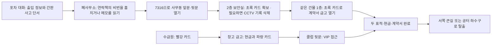

# 야행 v91 · 서기 자세와 의뢰 공간 개편

주요 의뢰는 VIP, 대청소, 배신 세 개로 정리했다. 장부 털기·잔칫날·본부와 기존 완료 기록·체크포인트는 ‘이전 의뢰’에서 유지한다. 기본 진행 순서와 표시 번호도 01→02→03으로 맞췄다.

이번 변경은 빈 건물을 목적지로 한 번씩 더 방문하게 만드는 방식 대신, 정보·출입·작업·탈출이 연결되도록 구성했다. 첫 공략 15~20분은 설계 목표이며 실제 플레이로 측정한 결과가 아니다. 숙련 플레이의 짧은 우회 경로는 허용한다.

## 대청소: 같은 사무동을 두 번 다르게 사용

비밀번호는 새 사무동 출입문에 실제로 적용된다. 초록 카드는 남쪽 주택의 임의 침실에서 사무동 2층으로 옮겼다. 2층에서 접근을 준비하고 1층에서 계약서를 회수하므로 같은 공간의 기능이 이어진다. 창문·옥상·락픽을 이용한 다른 침투 방법은 남아 있다.

| 장소 | 역할 | 연결되는 행동 |
| --- | --- | --- |
| 북서쪽 폐사무소 | 연락책과 출입 메모 | 비밀번호를 훔치거나 메모를 읽는다. 지붕 없이 벽·잔해를 이용해 접근한다. |
| 창고 | 현금 금고 | 수금원의 빨강 카드 → 현금과 클럽 뒷문 파랑 카드. |
| 사무동 | 출입·보안·계약서 | 비번으로 진입 → 2층 카드·보안실 → 1층 계약서. |
| 클럽 | VIP와 경호 | 앞문 경호·추가 호위와 뒷문 접근을 비교한다. |
| 남서쪽 빌라 | 조직원 숙소 | 의복 확보와 옥상 관측을 위한 선택 경로. |
| 남쪽 공터 적치장 | 은폐·우회·이탈 | 차량·컨테이너·수거함·하수구. 건물과 옥상은 제거했다. |
| 포차 | 사전 정보 | 연락책 위치, 카드와 금고의 관계, 수금원 사고 동선을 듣는다. |
| 남동쪽 건달파 보급처 | 선택적 보급 | 위험을 감수하면 락픽·다트를 하나씩 추가 확보한다. 필수 목표가 아니다. |

## 세 의뢰의 차이

| 의뢰 | 집중하는 문제 | 이번에 반영한 변화 |
| --- | --- | --- |
| 01 VIP | 경호와 표적을 분리하고 접근 방법 선택 | 전담 호위 추가. 배탈약 경로에서는 호위가 화장실 밖에서 기다리고, 표적이 나오면 다시 따라간다. |
| 02 대청소 | 여러 목표의 순서와 자원 배분 | 폐사무소·사무동 출입·카드·금고 연결, 공터 탈출, 선택 보급, VIP 호위 추가. |
| 03 배신 | 장비 없는 탈출·증거 회수 | 2층의 실제 CCTV와 보안실을 연결했다. 녹화됐다면 기록을 정리하고 이탈한다. |

주요 세 의뢰에서 플레이어의 불법 행동이 CCTV에 녹화되면 탈출 전에 보안실에서 신원 기록을 지워야 한다. 정상적인 공개 구역 보행이나 시체만 찍힌 경우는 이 조건을 만들지 않는다. 카메라를 피하거나 미리 껐다면 삭제 작업은 추가되지 않는다. 서치라이트도 녹화로 취급하지 않는다. 변장이 범행 녹화 속도까지 늦추던 부분을 수정했다.

## 주인공 서기 자세

걷기 프레임을 멈춰 쓴 골반·상체 기울기를 원본 Idle로 교체했다. 척추를 먼저 세우고 팔을 맞춰 손과 팔이 몸 안으로 들어가지 않게 했다. 발과 무릎의 부모가 다른 모듈형 리그에 맞춰 원본 발 접지를 유지했다.

기본·정장·작업복·조직원 복장 네 시트의 idleC만 부분 재생성했다. 8방향 × 2프레임 × 4복장 = 64개 자세를 검증했고, 다른 애니메이션의 픽셀은 그대로다. 새 런타임 3D 엔진이나 모델을 추가하지 않았다.

## 저장·공간 판정

공터·폐허는 높이 0의 외부 공간이다. 기존 건물 그림·문·계단·옥상·두꺼비집이 남지 않게 했다. 공터 컨테이너의 높이와 사다리는 실제 그림에 맞게 별도로 유지한다. 구버전 저장의 제거된 위층, 숨긴 기절 대상, 수거함 보관 수량, 체력·카드·회수한 물건을 보존하며 새 지형으로 복구한다.

## 검증 범위

- 관련 회귀 16종 통과. 서기 자세 원본 렌더 검사 64건 및 변경 대상 외 프레임 동일성 확인.
- 6개 지도 × PC/모바일 × 배치 3종 = 목표 수행·탈출 경로 36건. 이 검사는 진행 판정 확인을 위해 NPC를 정지시킨다. 사람의 첫 공략 시간이나 실전 난이도를 대신 측정하지 않는다.
- 실제 AI가 켜진 VIP 배탈약·화장실 왕복·사고·금고·뒷문 경로, 변장·추격·세력 전투 검사.
- 주요 3개 보안실의 접근 가능성, 녹화 전후 탈출 조건, 기록 삭제, 저장 복구, 코드 실물 출처와 문 매칭, 포차 대화, 호위 분리, 기존 저장의 공간·인물·기절 대상 복구 확인.

[실제 전후 화면과 장소별 설명](mission-rework/index.html)
