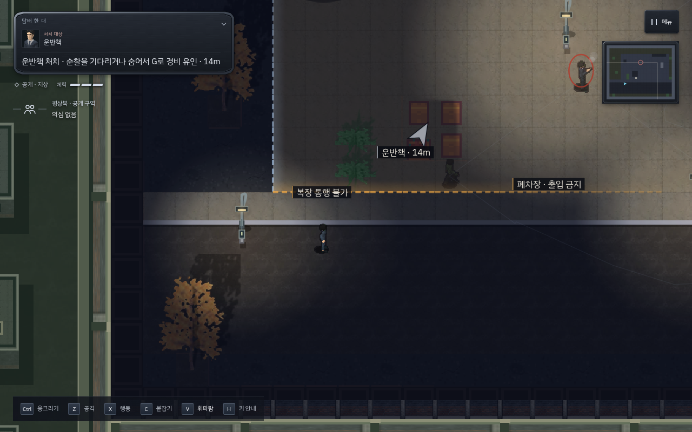
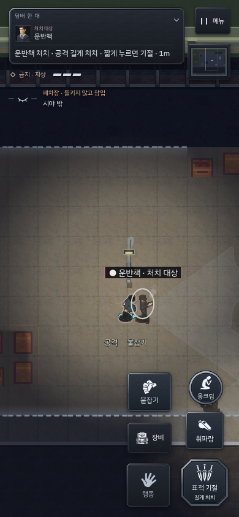
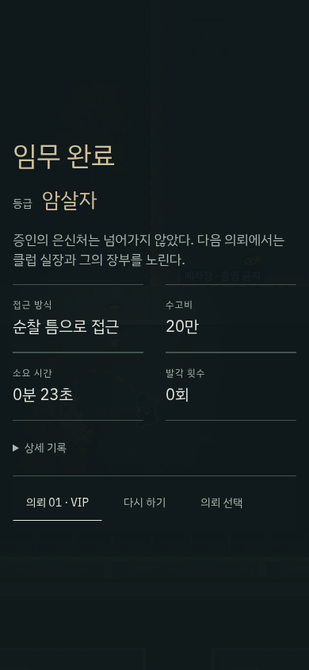

# v174 · 첫 암살부터 시작

첫 경험의 문제는 목표 설명의 양보다 순서였다. 시야·소리·제압·CCTV 연습과 금고 준비를 앞세워, 플레이어가 암살의 재미를 확인하기 전에 규칙을 배워야 했다.

새 시작은 실제 짧은 의뢰 **담배 한 대**다. 증인의 은신처를 넘기는 운반책 한 명과 순찰 경비 한 명을 둔다. 공개 골목에서 상황을 보고, 순찰이 비는 때에 접근하거나 풀숲에서 휘파람으로 경비를 유인한다. 표적을 처치한 뒤 들어온 골목으로 탈출한다. 기다림·유인은 선택이며 완료를 위한 단계나 특정 경로를 강제하지 않는다.

CCTV·금고·복장 변경·기술 구입을 첫 의뢰의 전제에서 뺐다. 기존 탐지·소리·근접 접촉·기절/처치·시체 발견·탈출 판정을 쓴다. 플레이어 면역, 자동 처치, 임시 암살 기술을 추가하지 않았다. 시작 예산 4P는 유지한다. 첫 의뢰는 영구 기술 포인트를 지급하지 않는다.

새 저장은 p0 → VIP → 대청소 → 배신 순서로 추천한다. 연습은 의뢰 선택의 연습 탭에서 계속 플레이할 수 있다. 주요 의뢰를 이미 깬 저장에는 새 프롤로그를 강제하지 않는다. 기존 의뢰 번호와 스테이지 인덱스를 유지하고 p0를 끝에 추가했다.

플레이에서 찾고 다시 확인한 수정:

- 표적과 우회로가 보이는 출발점, 소리가 통하는 적치물 배치와 순찰로.
- 실제 근접 공격이 가능한 순간에만 처치 입력 안내. 기절·운반·은닉 상태에는 마무리 방법을 안내.
- 시야 밖인데도 ‘시야 안’이라고 말하던 노출 문구를 실제 관찰과 잠재 위험으로 구분. AI 탐지 조건은 유지.
- 통행 허용 상태의 조용한 경비는 옅은 시야 외곽선으로 표시. 전술 지도와 주시는 기존 상세 범위를 표시.
- 대각선으로 장애물을 피할 때 자동 엄폐에 붙지 않게 진입 방향을 조정. 벽을 곧게 미는 의도적 엄폐는 유지.
- 실제 시간 모바일 재플레이에서 확인한 비모달 무전창의 이동 터치 가로채기를 수정.

검증 자료는 [반복 검토](opening-v174/review.json), [두 접근법 × 두 입력 방식](opening-v174/native-approaches.json), [일반 브라우저 시간 재플레이](opening-v174/realtime-review.json)에 있다. 고정 시계 테스트는 성공 가능성과 입력 회귀 검증이며, 일반 사용자 플레이 시간이나 재미의 증거로 해석하지 않는다. 규칙 검증은 `tests/rev/t_first_contract.py`, 실제 입력 경로는 `tests/tutorial/first_contract_walk.py`로 재현한다.

첫 의뢰의 학습 부담과 이동 방해는 줄었다. VIP의 시스템 밀도, 첫 의뢰 두 경로가 같은 후방 제압으로 끝나는 한계, 장기 재플레이 동기는 후속 검토 대상이다. 이번 변경만으로 상용 재미가 검증됐다고 판단하지 않는다.
