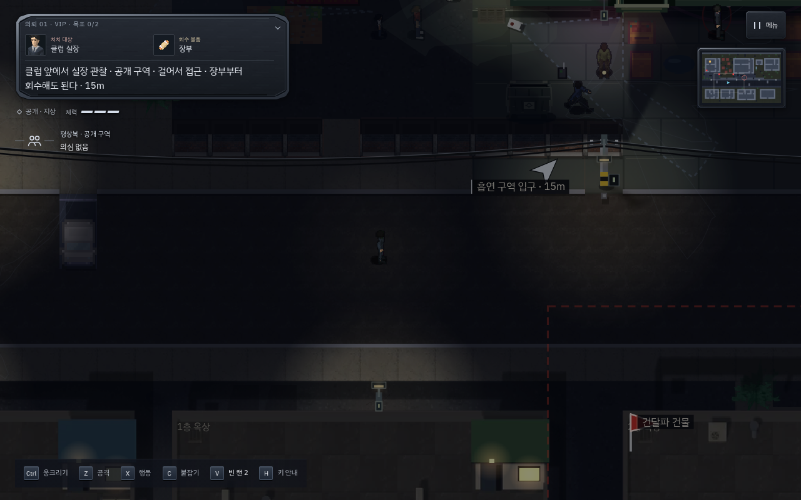
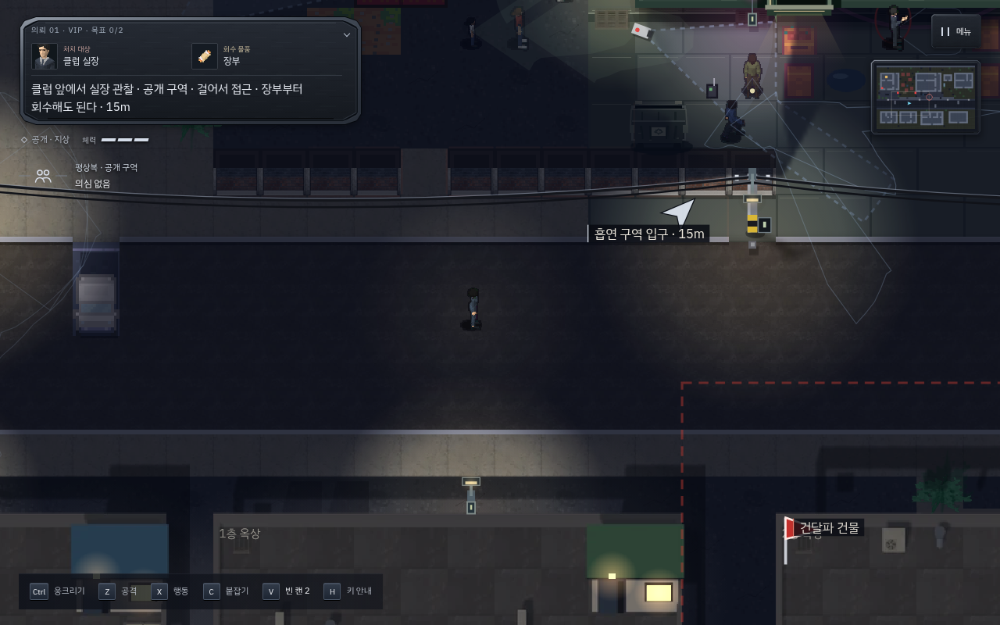

# v177 · 원작 복귀와 시야·행동 안내 개선

Godot 시제품을 후속 게임으로 발전시키는 작업을 중단하고 원작 v176을 기준으로 복귀했다.
Godot 추가·보완 커밋의 활성 프로젝트와 웹 배포물을 제거했다. 이전 시제품 주소는 원작으로 이동한다.
기존 작업은 Git 이력에 남아 있고, 원작 저장 형식과 진행 데이터는 변경하지 않았다.

## 확인하고 고친 부분

원작의 첫 의뢰를 완료하고 같은 저장에서 VIP로 넘어가는 과정을 PC와 모바일에서 먼저 플레이했다.
원작의 도시·골목·옥상·실내, 캐릭터·모션·서체와 의뢰 구성을 기준으로 유지했다.
`src/stages`, `src/art`, `src/fonts`, `src/club-study`, `src/js/ai`, `src/js/interaction`은 v176과 동일하다.

1. **경비 시야의 가독성.** 공개 구역의 평상시 경비는 테두리 불투명도가 약 3.4~7.6%까지
   낮아졌다. 근처 경비의 경계는 약 48%, 멀리는 14%로 표현하고, 내부 채움은 옅게 유지했다.
   의심·발각은 기존 노랑·빨강 계열을 유지하며 더 분명하게 표시한다. 화면 배율에 맞춰 선 두께도 보정한다.
   시야 모양을 만드는 광선·조명·연기·벽 판정과 실제 AI의 발견 범위는 바꾸지 않았다.
2. **선택한 행동과 위험 안내 일치.** 옷을 갈아입거나 훔칠 대상을 선택해도, 가까운 경비에 대한
   공격 가능성이 위험 안내를 ‘제압·처치’로 덮었다. 이제 선택한 환경 행동을 우선한다.
   계단을 선택하면 목적 층의 복장 조건을 먼저 표시하고, 공격 안내는 해당 안내가 없을 때 표시한다.
3. **CCTV 작업 시점.** 전선 분리가 실제 CCTV 시야 안에 걸리면 ‘카메라가 돌아간 뒤 작업’이라고
   표시한다. 별도 버튼이나 다트를 추가하지 않았으며 기존의 전선 분리 기능과 녹화 판정 그대로다.

## 검증

- 핵심 회귀 **74개 모두 통과**. 빌드 파이프라인 7검사·스프라이트 소유권·도달 검사 포함.
  [실행 기록](original-v177/core.txt)
- [새 규칙 검사](original-v177/rules.json): PC, 모바일 세로·가로에서 실제 캔버스 시야 테두리와
  단계별 표현, 표시 계산의 게임 상태 비변경, 공격 후보 옆의 옷 갈아입기 안내,
  계단의 보안 층 출입 안내, CCTV 전선 작업 문구를 검사했다. 좌표와 상태를 준비하는 통제된 검사다.
- [일반 시간의 첫 의뢰 → VIP 연속 플레이](original-v177/campaign.json): PC·모바일 모두
  엔진 API·고정 시계·난수 시드 없이 키보드/터치로 첫 의뢰를 완료하고 같은 저장에서 VIP로 진행했다.
  두 환경 모두 첫 의뢰 발각 0회였다. 관찰 사이에는 게임 메뉴로 일시정지했다.
- [원작 VIP 전체 플레이](original-v177/vip.json): 모든 배우·보안 시스템을 켜고 PC·모바일 각각
  기술 없이 체력 3으로 탈출했다. 두 환경 모두 신원 발각·CCTV 녹화 0회, 시신 발견·경보 각 1회였다.
  옷 변경, 두 대의 전선 분리, 실제 비밀번호 입력과 문 닫기, 장부 회수, 탈출을 거쳤다.
  일반 RAF와 비고정 난수에서 좌표·선택지를 읽는 경로 도우미와 실제 입력을 사용했다.
  배우·체력·스킬·인벤토리·경보·목표를 변경하지 않았다.

알고 있는 경로를 이용한 개발자 플레이다. 초보자 학습 시간이나 게임의 재미를 입증하는 사용자 연구는 아니다.

별도 실시간 플레이이므로 인물의 순찰 위치와 움직임은 이미지 사이에 차이가 있다.
