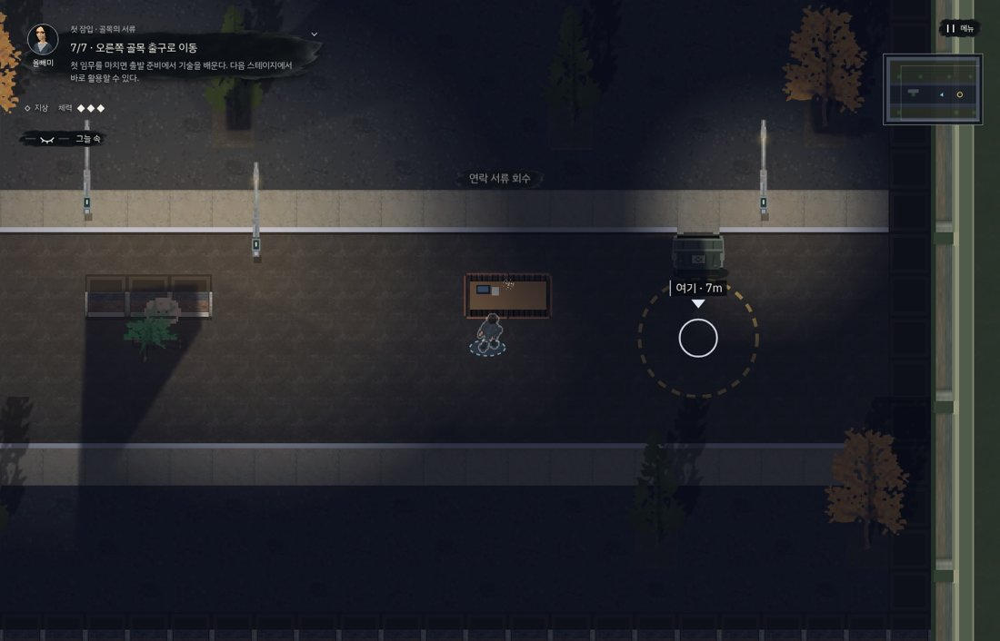
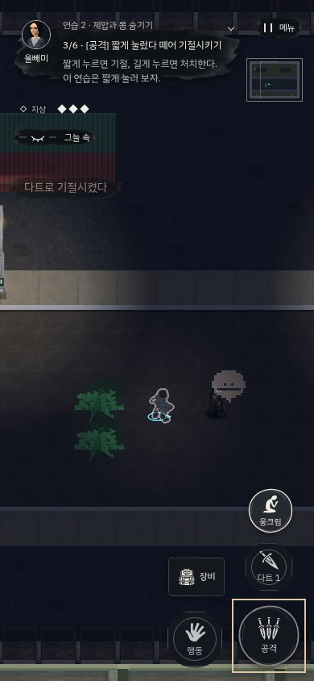

# 첫 잠입과 출발 준비 — v202

첫 연습을 이동 조작 목록에서 작은 임무로 바꿨다. 새 저장은 **풀숲으로 접근 → 등 뒤 제압 → 옮겨 숨기기 → 책상 서류 회수 → 오른쪽 골목 탈출**을 한 장소에서 완료한다. 그 뒤에 기술을 배우고 첫 암살 의뢰로 이어진다.

## 기술을 배우는 시점

- 첫 스테이지 도중 기술 구매를 요구하던 단계를 없앴다. 초반 제압·옮기기도 실제 입력으로 사용할 수 있게 했다.
- 첫 클리어 후 준비 화면에서 4P를 사용한다. 이후에도 클리어와 다음 출발 사이에 학습하며 기존 선형 진행·포인트 소진 흐름을 유지한다.
- 현장의 K/일시정지 메뉴는 보유 기술 확인·장착용이다. 구매와 초기화는 잠근다. 첫 스테이지 이전의 새 저장도 구매할 수 없다.
- 보유 기술을 튜토리얼에서 일괄 비활성화하던 규칙을 없앴다. 배운 다트·연막 등은 연습에도 지급되고 사용할 수 있다. 입문 단계의 휘파람 기본값이 보유 도구 사용을 덮어쓰던 문제도 수정했다.

## 행동이 달라져도 이어지는 안내

처음에 위쪽 등을 먼저 꺼도 현재 목표와 도착점은 유지된다. 목표 원에 실제로 도달한 뒤 다음 안내로 넘어간다. 붙잡기나 은신에 들어가면 탈출·제압 조작을 안내하고, 숨기는 도중 경비가 깨어나면 현재 위치의 등 뒤 접근부터 다시 안내한다. 미리 서류를 가져가거나 감시를 끊어도 완료할 수 없는 과거 행동을 요구하지 않는다. 조명 연습의 파손된 등도 소등으로 인정한다.

## 서류·복장·CCTV

- 서류 행동에 존재하지 않는 `itemActions.label`을 출력해 `undefined`가 나오던 문제를 고쳤다. 실제 물품명과 ‘챙기기’를 쓴다.
- 초록 사각형 대신 접힌 재킷·앞치마·종이 폴더를 사용한다. 기존 캐릭터의 투영에 맞춰 직접 만든 원본을 Blender에서 2D WebP 4장으로 구웠다. 총 6,036바이트이며 외부 구매나 3D 런타임은 없다. 접지 그림자·기존 조명·상호작용 위치를 유지한다.
- 관제실 조작의 실제 효과는 감시망 정지와 남아 있는 녹화 기록 제거다. 기록이 없으면 **‘감시망 정지’**, 기록이 있으면 **‘감시망 정지 · 녹화 기록 지우기’**, 이미 정지한 상태에서 기록만 남으면 **‘녹화 기록 지우기’**로 표시한다. 기록이 없는데 삭제했다고 말하지 않으며 과거 촬영 통계는 보존한다. 관제실 외 탐조등의 별도 전원 규칙은 바꾸지 않는다.

## 실제 입력 검증

[PC 기록](tutorial-v202/pc.json) · [모바일 기록](tutorial-v202/mobile.json)

새 저장에서 일반 브라우저 시간·기본 적·실제 키보드/터치로 첫 스테이지와 첫 암살 의뢰를 연속 완료했다. 플레이어 이동이나 적·기술·체력 상태를 강제로 바꾸지 않았다. 처음에 위 조명을 끄는 우회도 포함한다. 두 기기 모두 체력 3·직접 발각 0이었다. 첫 스테이지의 게임 내 시간은 PC 약 28초, 모바일 약 37초다. 이는 알려진 동선으로 진행한 개발자 검증이며, 초보자 평균 시간이나 재미의 객관적 증명은 아니다.

클리어 준비에서 실제 구매한 다트를 보존한 채 선택 연습 `t0`로 진입해 발사·기절·탄수 감소도 PC와 터치 양쪽에서 확인했다. 이 마지막 구간은 선형 캠페인 다음 에피소드가 아닌 별도 연습 선택 검증이다.

별도 회귀 검사는 구매 가능 시점 3개 화면 크기, 학습·초기화 금지, 조명 선행 조작, 경비 기상, 서류 이름, CCTV 상태 3종, 에셋 디코드를 확인한다. 비교 화면은 정지 시간·지정 위치에서 같은 게임을 촬영했으며 실제 임무 검증과 구별한다. 재생성 도구는 `tools/capture_tutorial_rework.py`, 원본 에셋 도구는 `tools/prerender/bake_field_items.py`다.
