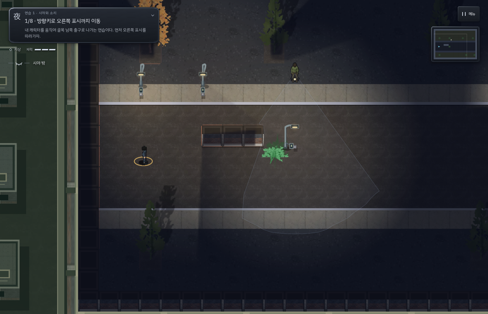
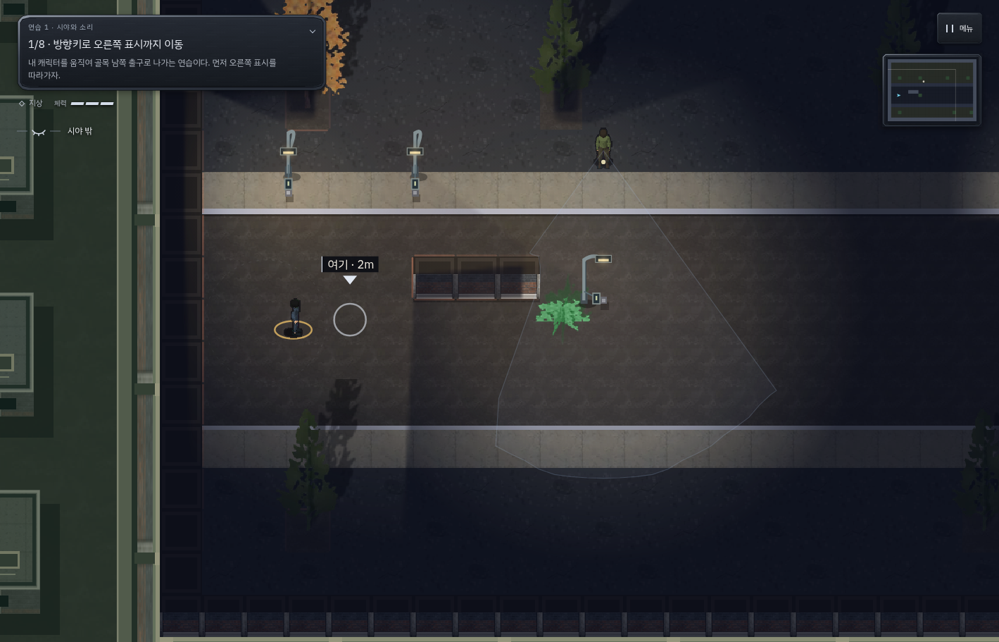
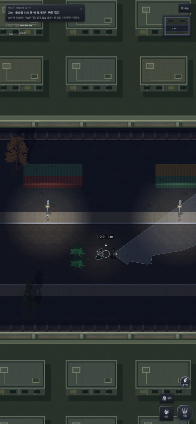

# v178 · 가까워지면 사라지던 연습 이동 표시

사용자 스크린샷의 ‘연습 1 · 시야와 소리’ 1/8 단계를 일반 시간의 실제 키보드 조작으로 재현했다.
플레이어가 x=120에서 x≈151로 조금만 움직여도, 목표 x=216에 도착하기 전에 표시가 사라졌다.
목표는 1/8 단계에 그대로 남아 있어 ‘오른쪽 표시까지 이동’이라는 안내와 화면이 맞지 않았다.
[수정 전 재현 실패 기록](tutorial-v178/reproduction.txt)

## 원인과 수정

`drawGoal`은 거리를 반올림해 3m 미만인 모든 연습 목표를 숨겼다. 손에 닿는 행동 대상을
버튼 안내로 대신하려던 처리가 이동 목적지까지 숨겼다. 연습 1의 멈추기, 연습 2의 등 뒤 접근도 같은 영향을 받았다.

목표와 버튼 강조가 같은 `tutorialCue()` 판정을 공유하게 했다. 이동·달리기·웅크리기 안내는
목적지 표시를 유지하고, 가까운 공격·휘파람·운반 대상은 기존 행동 안내로 표시한다.
목적지와 실제 완료 조건, 경비 판정, 체크포인트 형식은 바꾸지 않았다.

이전 좌표 기반 경로 검사는 목표에 도달할 수 있는지만 확인해 이 문제를 놓쳤다.
이번에는 가까워진 상태에서 실제 캔버스가 목표 표시를 그리는지도 검사했다.

## 실제 플레이

`tests/tutorial/first_steps_live.py`를 일반 RAF와 비고정 난수에서 실행했다.
키보드/실제 CDP 터치로 움직이고 목표 좌표와 상태를 읽는다. 게임 시간, 위치, 배우, 체력, 진행을 직접 변경하지 않는다.
캔버스의 원 그리기를 관찰해, 아직 끝나지 않은 이동 목표가 실제로 표시되는지 확인한다.

- [PC](tutorial-v178/pc.json), [모바일 터치](tutorial-v178/mobile.json): 첫 연습 8단계와 다음 제압·몸 숨기기 연습을 완료하고 신분·CCTV 연습으로 넘어갔다.
- 두 환경 모두 체력 3, 발각 0. 숨기·휘파람 유인·탈출, 뒤로 접근·기절·운반·풀숲에 숨기기를 실제 입력으로 수행했다.
- [표시 회귀 검사](tutorial-v178/markers.json): PC와 모바일 세로·가로·320px에서 가까운 이동 표시,
  가까운 행동 표시의 중복 방지, 도착 전 단계 유지, 체크포인트 복원, 다음 연습의 접근 표시와 캠페인 분리를 확인했다.

알고 있는 연습 경로를 이용한 개발자 플레이이며, 초보자의 학습 시간에 대한 사용자 연구는 아니다.

