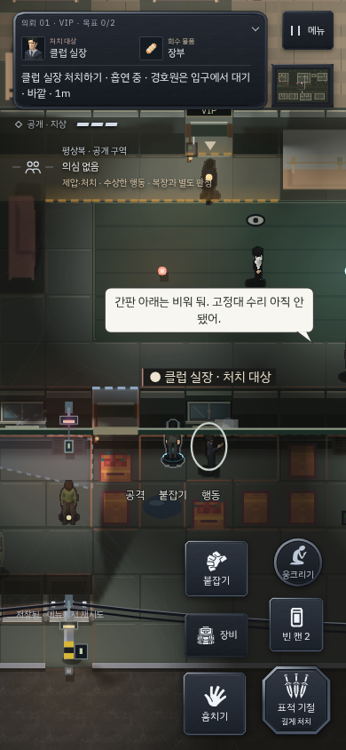
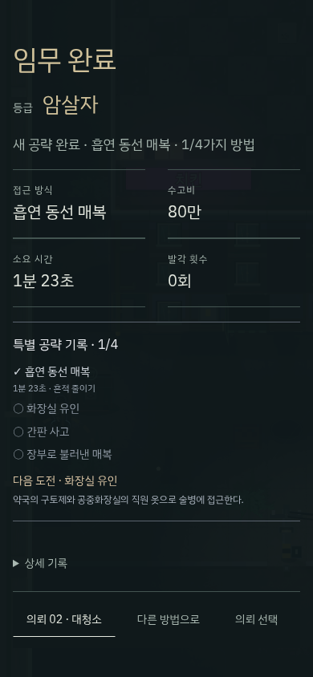

# v175 · 관찰에서 선택으로 이어지는 VIP

첫 암살 뒤 VIP에 들어오면 금고 번호, 복장, CCTV, 장부부터 처리해야 해서 암살 대상과 기회를 만나기까지 준비가 길었다. 이번에는 공개 구역인 클럽 앞에서 시작한다. 기본 추적은 흡연 구역 입구 → 실제 관찰한 실장 → 떨어진 금고 번호 메모 → 장부 → 탈출로 이어진다. 장부나 다른 기회를 직접 선택하면 그 선택을 유지한다.

실장은 처음 24초 동안 담배를 피운다. 접근 중 곧바로 다른 장소로 떠나던 문제를 줄였다. 흡연 장소에는 실제 충돌과 시야 차단을 가진 적치물을 두고, 출입구와 외부 순찰 동선을 구분했다. 문지기·경호원·순찰·CCTV의 탐지 능력은 낮추지 않았다. 처치 후 시체가 발견되면 수색이 시작될 수 있다.

실장은 실제로 회수해야 하는 금고 번호 메모를 지닌다. 사무동 앞에는 예비 경비 재킷을 배치해 기술 없이 통행 복장을 구할 수 있다. 통행 허용과 불법 작업 판정은 별개다. 가능한 근접 공격에도 기존 CCTV/목격 판정에 따른 위험 안내를 표시한다. 살아 있는 표적이 남은 이전 체크포인트에는 메모만 보완하며, 배우를 이동시키거나 기존 저장을 초기화하지 않는다.

다시 할 목적은 성공한 방법을 기록하는 데서 시작한다. 흡연 매복·화장실 유인·간판 사고·장부로 불러낸 매복을 각각 기록하고, 방법별 최고 시간과 은밀 완료 여부를 표시한다. 은밀 완료는 발각·경보·비표적 처치·시체 발견·목격·CCTV 기록이 없는 완료다. 결과 화면의 기존 재시도 버튼은 아직 완료하지 않은 방법을 제안하며 해당 준비 지점으로 안내한다. 모든 방법을 모은 뒤에도 기록과 흔적을 줄일 수 있다. 공략 수집은 기술 포인트와 독립적이며 중복 결과 처리로 보상을 늘리지 않는다. 자유 접근도 그대로 성공할 수 있다.

공략 판정은 처치/제압 시점의 실제 상황을 저장한다. 과거에 흡연을 봤다는 이유로 뒤이은 전투를 흡연 매복으로 기록하지 않는다. 전화로 부른 표적이 거래방에 도착하는 순간의 공격도 해당 공략으로 인정한다. 간판 수동 추적에는 실제 옥상 높이를 전달해 지상 좌표로 잘못 안내하지 않는다.

검증과 한계:

- 핵심 회귀 72개 중 71개가 최초 통과했다. 남은 `t_review_fixes`의 폐기된 금고 우선 기대를 관찰 우선으로 수정한 뒤 단독 재검사에 통과했다. 빌드 파이프라인 7검사·스프라이트 소유권·도달 검사도 통과했다.
- 새 공략 기록·상황별 판정·저장 유지·실패 시 미지급·보상 중복 방지·기존 버튼 재시도를 PC와 모바일 3크기에서 검사했다. 전화 도착/이탈/재통화/추적 유지와 실제 입력 회귀도 별도로 통과했다.
- [실제 입력 전체 경로](vip-v175/native-walks.json): 흡연 매복과 전화 유인 각각 PC/모바일에서 출발부터 탈출까지 완료했다. 모든 AI·감시가 작동하고 습득 기술은 없다. 경로 안내기는 좌표를 읽으며 입력을 실행한다. 고정 시계/시드는 재현용으로 쓰였으므로 시간 기록을 초보자의 플레이 시간으로 해석하지 않는다.
- [일반 시간 전체 경로](vip-v175/realtime-walks.json): 일반 RAF·비고정 난수의 흡연 매복도 PC/모바일에서 완료했다. 두 경우 모두 체력 3·습득 기술 없음·발각 0, 시체 발견과 경보 각 1이었다. 전화 경로의 고정 시계 완료에는 발각 2·경보 1이 있었다. 은밀 완료에 성공했다고 주장하지 않는다.
- [화면 안내만 따르는 첫 접근](vip-v175/ui-first-approach.json): 엔진 API를 읽지 않고 일반 시간에 키보드/터치로 표적을 관찰했다. 네이티브 전체 경로 검사와 별개이며, 전체 의뢰의 블라인드 사용자 테스트는 아니다.
- 구토제·간판·뒷문은 두 시드 × 두 입력의 12개 실제 AI 장면으로 재검사했다. 이 검사는 준비 상태/위치 조절이 포함되며 전체 도보 클리어를 뜻하지 않는다.

재현 코드는 `tests/rev/t_vip_choice_loop.py`, `tests/rev/t_rendezvous.py`, `tests/tutorial/vip_choices_walk.py`에 있다. 마지막 스크립트에 `YH_REALTIME=1`을 주면 일반 시간으로 진행한다. 공략별 기록과 첫 동선이 작동하는 것은 확인했지만, 장기 재미와 구매 의사는 독립 사용자 평가가 필요하다.

