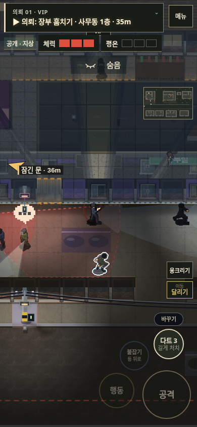
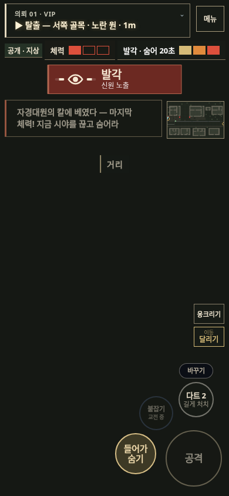

# v121 — 대표 의뢰 「VIP」 개선

의뢰 하나에서 관찰·접근·처리·탈출의 흐름을 검증하는 작업이다. 목표는 장부 회수와 실장 처치이며 순서는 자유다. 기다려 직접 처리하거나, 간판 사고·구토제 유인·장부를 이용한 전화 매복 중 원하는 방법을 택할 수 있다.

## 설계와 적용

| 구간 | 발견한 문제 | 적용 |
| --- | --- | --- |
| 경비 유인 | 식당·화장실 사이에서 경비가 계속 경로를 다시 잡음. 동선 위 의자와 직원도 우회를 유발함 | 막힘 판단을 최종 목적지까지의 직선 거리에서 현재 경로의 다음 지점까지의 진행으로 변경. 정상적인 우회를 유지한다. 통로의 의자를 덜고 직원들을 식당 오른쪽 공간으로 옮김 |
| 표적 관찰 | 흡연 때 혼자라는 정보와 실제 호위 동선이 일치하지 않음 | 흡연 구간에는 호위가 입구에서 큰길을 지킨다. 간판 낙하 범위 밖에 서도록 정지 거리까지 반영함. 화장실·전화 매복의 별도 대기도 유지 |
| 일과 읽기 | 일과표의 흡연·음주를 화면에서 읽기 어려움 | 실제 해당 장소에 머무를 때 소비 동작을 적용하고 흡연 연기를 표시. 다른 곳으로 이동하면 해제함 |
| 단서 | 같은 정보를 긴 잡담과 농담으로 전달함 | 금고·술병·흡연 관련 대화를 각각 두 줄로 정리. 메모에는 금고 번호와 파란 카드키 용도를 남김. 단서 발견이 의뢰 목표를 자동으로 바꾸지는 않음 |
| 처리 후 탈출 | 사무동 쪽에서 처리해도 동쪽 끝으로만 이동 | 기존 동쪽 큰길에 서쪽 골목을 추가. 가까운 골목과 긴 큰길을 선택할 수 있으며, 수색이 시작되면 기존 경비 배치 시스템이 두 출구에도 작동 |
| 다시 시도 | 놓친 기회가 실패처럼 느껴질 수 있음 | 흡연 일과의 다음 방문을 실제 AI로 확인. 놓친 방문이 의뢰를 끝내거나 특정 공략을 요구하지 않음. 목격한 흡연 동선에서 매복했다면 결과에도 해당 접근 방식을 기록 |

처치의 길게 누르기 규칙, 기존 버튼 위치, 오른쪽 미니맵, 선택형 단서 추적은 유지한다. 새 필수 준비 단계나 제한 시간은 추가하지 않았다.

## 실제 진행 검증

전체 NPC·카메라·탐지·피해를 활성화하고 다음 경로를 끝까지 진행했다.

**약국 → 포차 유인 → 경비 비살상 제압·변장 → 사무동 2층 메모 → 1층 금고 장부 → 다트로 해당 CCTV 무력화 → 내선 호출 → 사물함 대기 → 실장 처치 → 서쪽 골목 탈출.**

| 환경 | 완료 시간 | 체력 | 발각 | 결과 |
| --- | --- | --- | --- | --- |
| PC 브라우저·키보드 이동 상태 | 3분 16초 | 3 | 0 | 장부로 불러낸 매복, 서쪽 탈출 |
| 모바일 크기·터치 브라우저·조이스틱 이동 상태 | 3분 16초 | 1 | 3 | 발각 후에도 목표를 마치고 서쪽 탈출 |

자동화 컨트롤러는 실제 이동 판정·일반 행동 함수를 사용하고 대화를 자동으로 넘긴다. 좌표 이동, 체력 보충, 변장·열쇠·목표 달성 지급은 하지 않는다. 맵 구조를 알고 계획한 검사이며 사람이 처음 접한 플레이의 발견성이나 재미를 증명한 결과로 보지는 않는다. 모바일의 세 차례 발각도 검증 결과에 포함한다.

재현 스크립트: `tests/rev/t_vip_showcase.py`.

## 추가 검사

- 표적·호위의 전체 AI 일과: 3개 시드 × PC·모바일 6장면. 첫 흡연 방문과 놓친 뒤 두 번째 방문 확인. 호위는 낙하 구역 밖에서 대기하고 목표는 계속 유지됨.
- 구토제·간판·뒷문: 전체 AI가 활성화된 통제 시작 장면 12개. 준비 장비·시작 위치는 검사 조건이며 전 구간 걷기 검사는 위 매복 경로와 구분함.
- 식당 유인: 경비 일과만 활성화한 6경로, 전체 AI를 켠 PC·모바일 2경로. 이전 재현은 160초를 기다려도 화장실에 도착하지 못했다. 수정 후 같은 전체 진행 검사에서는 대기 약 60초 후 도착했고 처치 없이 경비복으로 사무동에 진입함.
- 기존 6개 미션 × 3개 배치 × PC·모바일: 36개 진행 경로 완료. 이 검사는 NPC를 정지하고 실제 이동·문·회수·처치·탈출의 연결을 검사함.
- 두 출구의 조기 탈출 방지, 정상적인 굽은 경로 유지, 옛 저장 파일의 출구·호위·직원 배치 복원 통과. 옛 저장의 직원은 새 자리까지 걸어가며, 진행 중인 전투·시체·목표 상태를 바꾸지 않음.
- 기존 전화 매복 6경로, 15개 환풍구 왕복·상호작용, 녹화 조건·기절 표적 판정, 자유로운 목표 안내, 제압 입력·소리 타이밍, 8개 조작 화면 조합, PC·모바일 연습→첫 의뢰 검사 통과.

[검증 결과 기록](vip-v121/validation.json)

## 화면

[PC 관찰 장면](vip-v121/pc-smoking.png) · [PC 전체 AI 진행 완료](vip-v121/pc-phone-clear.png)

이 의뢰를 기준으로 외부 플레이어가 단서를 발견하고, 실패 이유를 이해하며, 두 번째에는 다른 방법을 고르는지 확인하는 사용성 평가가 다음 검증이다.
