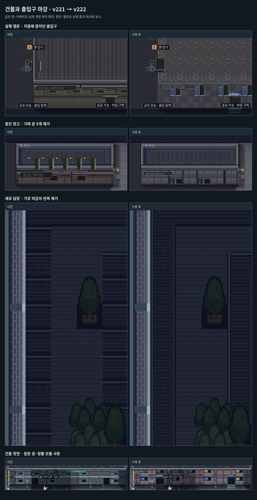

# 건물과 출입구 마감 · v222

지붕 가장자리에 숨은 옆문을 실제 출입 좌표에 문틀·문턱과 함께 표시한다. 정문·옆문·뒷문의 열림과 잠금 상태를 따르며, 지상 출입구가 옥상 위에 떠 보이지 않도록 층을 구분한다. 문턱은 캐릭터보다 먼저 그려 몸을 덮지 않는다.

## 원인과 수정

| 문제 | 원인 | 수정 |
|---|---|---|
| 문을 찾기 어려움 | 닫힌 건물의 지붕이 실제 옆문을 덮음 | 지붕 마감 뒤 실제 외벽 문틀을 표시하고, 바깥 바닥에 문턱을 연결 |
| 창고 위 초록 막대 5개 | 좁은 내부 통로의 바닥을 문 5개로 추론한 뒤 지붕 위에 다시 그림 | 연속된 좁은 통로는 문으로 생성하지 않음. 내부 문은 닫힌 지붕 위에 표시하지 않음 |
| 세로 담장의 줄무늬 | 각 48px 벽 칸에 북쪽 덮개와 아래 그림자를 반복 | 이웃 벽 연결 방향을 계산하고 노출된 가장자리만 마감 |
| 외벽의 작은 조각 반복 | 작은 벽 무늬를 넓은 면에 반복 | 구매 팩의 층 전체 패널, 산업용 창·사무동 창·상가 창틀·모서리 기둥으로 조합 |
| 창과 옛 마감의 중첩 | 새 창틀 위에 이전 실내 마감용 외벽 창을 다시 그림 | 새 외벽에서는 기존 중복 표현을 생략. 실내 창과 스위치 판정은 유지 |

처음 초록 막대를 간판이라고 설명한 것은 잘못이었다. 실제 렌더 호출을 추적해 문 그림임을 확인했다. 봉인 창고에는 새로운 출입구를 만들지 않았다. 구매 팩은 기존 29개 조합에 층·창틀·기둥·차양 11개를 더해 총 40개 조합을 사용한다. 원본 ZIP과 전체 타일맵은 저장소 밖에 유지한다.

- [구매 자산 출처·라이선스](../../src/art/dotonbori/LICENSE.txt)
- [원본 선택 영역과 해시](../../src/art/dotonbori/exteriors.json)
- [재현 도구](../../tools/import_dotonbori_exteriors.py)

## 검증

- [전 맵 배치 비교](geometry-comparison.json): 27개 맵의 층별 격자, 건물 경계·높이, 옥상 장애물·충돌, 계단, 조명과 적 배치가 v221과 동일하다.
- [문 비교](door-comparison.json): 모든 외벽 문·잠금문·게이트를 보존했다. 제거 대상은 잠기지 않은 내부 통로의 자동 생성 항목이다. 봉인 창고의 잘못된 문은 5개에서 0개로 줄었다.
- [회귀 검사](rules.json): PC·모바일에서 실제 정문 1개·옆문 1개, 문 열림·잠금 그림, 문틀과 실제 문 좌표 일치, 연속 세로 벽의 중간 덮개 0개, 문턱이 캐릭터를 덮지 않는 그리기 순서를 검사했다.
- [전체 외관 검사](coverage.json): 27개 맵의 새 외관과 102동의 불투명 지붕, 실제 옥상 장애물 그림을 확인했다.
- 외관·창문·조명·층 분리·동작·카메라·UI 등 19개 집중 검사와 임무 진행·옥상 동선 검사 2개 통과. 빌드 검사 8개, 물리 상태 검사 20개 그룹 통과. 조명 회귀 중 발견한 새 외벽 창의 회로 반영도 수정했다.
- [입력 재생 요약](native-summary.json): 첫 잠입 `tB`, 첫 암살 `p0`, 3층 미션 `e2`를 PC 키보드와 CDP 모바일 터치로 각각 완료했다. 6회 모두 체력 3·발각 0. 배우 위치·AI·체력·게임 시간을 변경하지 않는 알려진 경로의 재생이며, 초보자 이해도 조사와 실제 iPhone 시험은 아니다. 기록은 `opening-*.json`, `contracts-*.json`에 포함한다.
- 배포 패키지의 PC·모바일 이동, 메뉴·목표 정지/복귀, 한국어 폰트와 브라우저 리소스 해시 12개를 검사했다.

아래 비교는 같은 맵·카메라의 고정 렌더링을 확대한 것이다. 입력 재생 증거와 구분한다.

