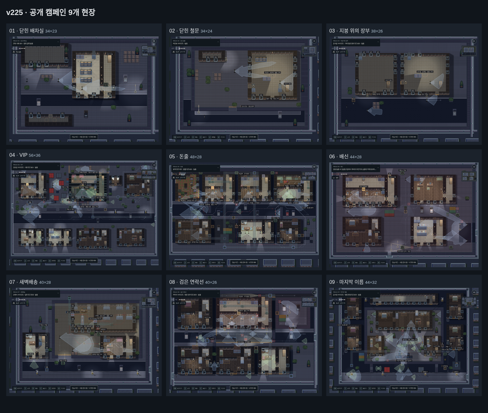

# 중복 의뢰 정리와 대사 수정 · v225

같은 금성 운송 배치를 다시 공략하던 **불 꺼진 출고동(p1), 야간 기록실(p2), 녹화된 얼굴(e1)**을 공개 캠페인과 의뢰 목록에서 제거했다. 진행은 12개에서 9개로 줄었다. 서로 다른 건물·도로·방 배치를 쓰는 현장만 남겼다. 과거 완료 기록과 이미 얻은 기술 포인트는 보존한다. 예전 정의는 저장 호환과 내부 회귀 검사에만 남으며, 메뉴에서 재활용 의뢰를 권하지 않는다.

## 남은 순서

| 순서 | 의뢰 | 이번 현장의 역할 |
| --- | --- | --- |
| 01 | 닫힌 배차실 | 제비의 서류를 찾으며 제압·변장·은닉을 실제로 사용한다. |
| 02 | 닫힌 철문 | 운반책 박인호를 처치한다. 1층 경비와 2층 표적이 있는 첫 암살 의뢰다. |
| 03 | 지붕 위의 장부 | 옆 정비동의 잠긴 창문, 3층과 지붕을 거쳐 거래소에 잠입한다. 문서윤과 원본 장부가 목표다. |
| 04 | VIP | 클럽 실장 강도윤, 장부와 별도 건물의 암호표를 공략한다. |
| 05 | 돈줄 | 장무혁·백철민과 현금·계약서를 찾는다. |
| 06 | 배신 | 감금에서 벗어나 제비의 기록을 찾는다. |
| 07 | 새벽배송 | 오태식과 명세서를 확보하고 배차를 중단한다. |
| 08 | 검은 연락선 | 까마귀와 원본 장부를 통해 최종 책임자를 확인한다. |
| 09 | 마지막 이름 | 윤서경과 명령 원장으로 증인 거래의 증거를 완성한다. |

[배치 검사 결과](layouts.json)는 층별 타일과 건물 형상을 함께 비교한다. 해시가 다른 것만으로 재미가 입증되는 것은 아니다. 위 실제 화면으로 단지·건물 배치도 확인했다. 후반부의 넓은 맵과 공통 도시 미술 스타일은 유지한다. 모든 후반 의뢰를 이번에 새로 제작했다는 뜻은 아니다.

## 이야기와 난이도 연결

박인호의 통화 기록에서 문서윤의 거래소로 바로 연결한다. 삭제된 간부를 찾아가라는 조직도·단서를 제거하고, 이후 회수한 자료가 다음 인물의 이름과 주소를 알려 주도록 연결했다. 공개 진행 경로와 기술 화면의 다음 의뢰도 같은 순서를 쓴다.

거래소는 경비 6명·필수 표적 2명에서 **경비 4명·필수 표적 1명**으로 줄였다. 간판 사고는 선택지다. 처음부터 다시 옷을 구하고 몸을 숨기는 체크리스트를 안내하지 않고, 철사와 창문으로 시작한다. 변장·조명·정문 경로는 계속 사용할 수 있다. 기존 배치 버전의 중간 저장은 새 배치로 시작하되 완료·보상은 남긴다.

실제 입력 재생에서 카메라 서비스 지점으로 가는 길이 카메라 시야를 지나가던 문제를 발견했다. 카메라를 없애거나 탐지를 약화하지 않고 작은 벽 배치와 오른쪽 통로를 정리했다. 오른쪽 벽 → 카메라 위쪽 → 전선 순서로 목표와 무전이 안내한다. 카메라는 장부 위치를 실제로 보고 있고, 작업 가능한 서비스 지점과 안내 통로는 시야 밖임을 따로 검사했다.

## 말투

무전·주요 표적의 통화와 혼잣말·경비의 반응·현재 에피소드의 시작 대사와 단서를 수정했다. 잘린 문장과 추상적인 위협 대신 누가 무엇을 하는지 말한다. 농담을 매 줄에 붙이지 않는다. 무전은 새 대화창을 늘리지 않고 기존 표시 시간을 사용한다.

| 이전 | 변경 |
| --- | --- |
| “등을 잡았어. 짧게 누르고 떼. 야근은 여기까지 시켜 주자.” | “지금 가까워. 아래에서 했던 것처럼 짧게 누르고 떼.” |
| “옷을 빌리자. 신입인 척하면 돼.” | “이제 경비 옷으로 갈아입자. 갈아입는 동안은 움직이지 말고.” |
| 박인호: “아직도 출발 안 했어? 오래 기다릴 생각 없어.” | “문서윤 씨, 나 벌써 도착했어요. 몇 분이나 더 기다려야 돼요?” |
| 강도윤: “내 클럽에서 감히! 문 막아, 당장!” | “뭐야? 저 사람 누가 들여보냈어!” |

“이탈”은 화면에서 “탈출”로 바꿨다. 종료 무전은 할 일이 끝났다는 사실, 노란 원으로 표시된 출구, 남아 있는 경비를 설명한다. 회수와 실제 탈출 판정은 그대로다. [현재 대사와 진행 자료](dialogue-and-route.json)에서 주요 문구를 확인할 수 있다.

## 검증 범위

공개 9개 현장을 렌더링하고 배치·메뉴·저장 호환·단서를 검사했다. 첫 세 의뢰는 정상 RAF와 AI를 켠 채 키보드와 CDP 터치로 재생한다. 배우·체력·게임 시간을 조작하지 않는 알려진 경로 재생이며, 초보자 이해도 조사나 실물 iPhone 테스트는 아니다. 후반 6개를 이번 변경에서 전부 직접 완주했다고 주장하지 않는다.

- 캠페인·대사·첫 의뢰·이야기·조직도·기술 준비·모바일 무전·월드 미술 등 집중 회귀 20개와 신규 배치 검사 통과.
- 빌드 파이프라인 8개, 물리 상호작용 20개 그룹 통과.
- 마지막 패키지의 PC·모바일 이동/일시정지/한글 폰트와 12개 콘텐츠 해시 검사 통과.
- 실제 입력 완료 기록은 [재생 요약](native-summary.json)에 보관한다.
