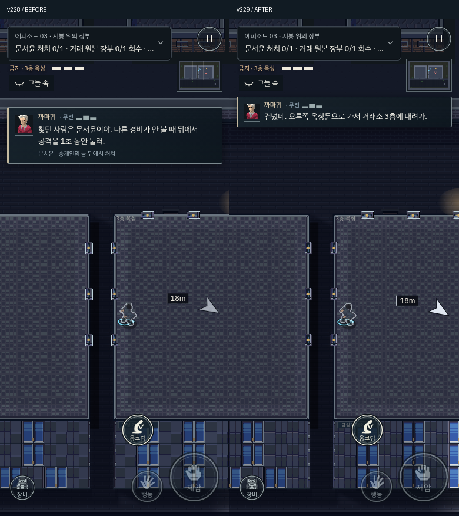
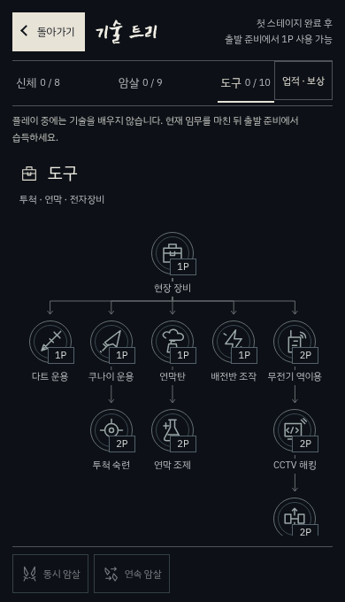
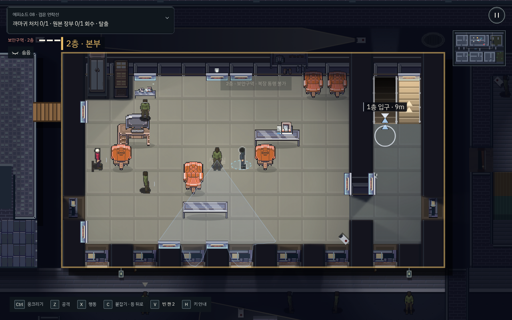

# v229 · 안내 순서, 행동 가독성, 모바일 화면 정리

첫 세 의뢰를 다시 플레이하며 확인한 문제를 수정했다. 현재 위치에서 필요한 지시가 나오고, 제압·운반 동작을 표시가 가리지 않도록 다듬었다.

- **위치에 맞는 무전**: 철사 확보 / 창문 잠금 해제 / 창문 넘기 / 층별 계단 / 옥상 진입 / 건너뛰기 / 거래소 옥상문 진입을 다른 안내로 구분한다. 과거에 들은 계단 무전 때문에 다음 층의 지시가 생략되지 않는다. 점프·통과 동작 중 잠깐 계산되는 목표는 무전으로 내보내지 않는다. 상황이 바뀐 뒤 이전 지시가 화면에 남지 않는다.
- **제압 순간 확보**: 동작 중과 접촉 결과 직후 0.55초 동안 목표 원을 감춘다. 첫 이동 목적지는 가까이 가도 유지한다. 따라서 첫 이동 안내를 고친다는 이유로 다시 깨뜨리지 않는다.
- **기절과 살해 구분**: 일반 기절 대상은 붉은 전투 원과 반복되는 살해 설명으로 강조하지 않는다. 운반·변장 안내가 남으며, 모바일 공격 버튼에는 중립적인 ‘기절 상태 / 길게 살해’를 표시한다. 사용자가 실제 공격을 길게 누르면 살해 준비를 명확히 표시한다. 의뢰의 필수 표적은 별도로 살해 필요성을 유지한다.
- **모바일 화면**: 무전의 중복 행동 줄을 생략하고 본문·초상 여백을 줄였다. 첫 지시는 본문에서 실제 왼쪽 드래그 조작을 알려준다. 읽을 시간을 준 뒤 이동하면 일반 무전을 접는다. 긴급 경고는 유지하고, 기존 무전 버튼으로 다시 읽을 수 있다.
- **기술 분야 선택**: 폭 1000px 미만에서는 선택한 분야만 표시하며 옆 분야가 잘리지 않는다. 분야를 바꿔도 모든 기술·선행 조건·비용과 구매 기능을 사용할 수 있다. 포인트 지급·학습 권한은 기존 규칙을 사용한다.
- **실내 용도 구분**: ‘돈줄’ 클럽 위층은 접객실 재료와 엇갈린 테이블, ‘검은 연락선’ 본부는 간부 책상·뒤쪽 회의 테이블·별도 업무 책상으로 나눈다. ‘새벽배송’ 위층은 기록 업무 공간, 사저 위층은 주거 재료를 사용한다. 기존 가구 두 쌍만 옮겼고 문·스위치·카메라·목표·순찰 지점을 변경하지 않았다. 공통 room patch 경로로 과거 체크포인트의 옛 충돌 칸도 복구한다.

## 검증

- 첫 의뢰 모바일, 두 번째 PC, 세 번째 모바일에서 일반 RAF·실제 키보드/터치 입력으로 완주했다. 모두 체력 3 / 발각 0이었다. 경로를 아는 개발자 재생이며 두 번째·세 번째는 해당 의뢰를 직접 선택한 테스트 시작 조건이다. 실기기 사용성 조사나 후반 모든 의뢰의 완주로 해석하지 않는다.
- 세 번째 의뢰의 실제 옥상 착지 뒤 새 무전이 보이는지 별도로 검사했다. `guidance.json`에 당시 목표·무전·표시 상태가 있다.
- 새 회귀 검사는 PC·모바일 각각 8개 경로 단계의 안내, 점프 중 억제, 접촉·정착 중 목표 표시, 기절 대상의 명시적 살해 의도, 분야 탭·무전 접기·다시 듣기를 확인한다. 바뀐 두 방은 이전 배치로 저장된 체크포인트를 재구성해 통행 칸 복구·새 가구·플레이어 탈출·순찰 지점을 확인한다.
- 기술·학습 시점·전투·운반·캠페인·인터페이스 검사 13개와 공개 9개 에피소드 실내 아트 검사를 통과했다. PC/모바일·가로·작은 화면의 UI 검사, 빌드 검사 8개, 물리 상호작용 20개, 패키지의 입력·폰트·12개 파일 해시 검사도 통과했다.
- 기존 가독성 검사는 현재 요약 목표 DOM, 실제 접촉 거리, 선택 캐시의 시간, 자동 심문 이전 시점, 물리 조명 스위치 조건에 맞게 테스트 시작 조건을 정리했다.

`proof.json`, `native-summary.json`, `coverage.json`, `checks.json`은 위 검증 범위별 기록이다. 정지 상태로 장면을 배치한 이미지와 실제 입력으로 완료한 기록을 구분한다.
