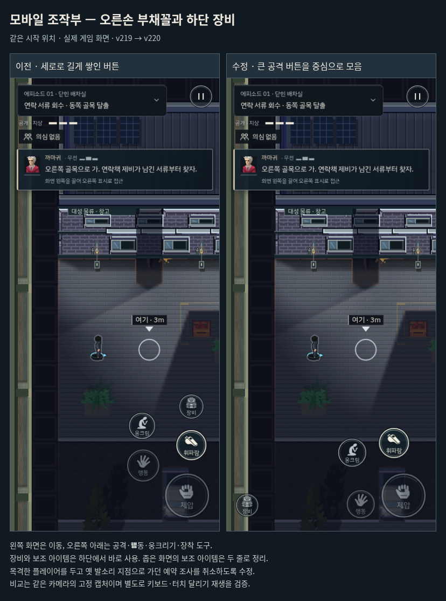
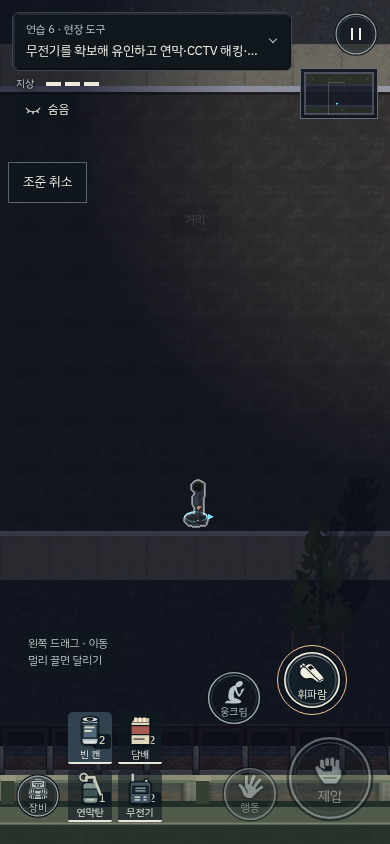

# 발소리·목격 우선순위와 모바일 조작 배치 · v220

달리기를 들은 경비가 짧게 멈춘 뒤 소리 지점을 조사하도록 예약한다. v219에서는 이후 플레이어가 실제 시야에 들어와도, 발견 게이지가 아직 낮아 순찰 상태라면 그 예약이 남았다. 플레이어가 지나가자 경비가 현재 본 사람 대신 이전 소리 지점을 조사했다. 같은 조건의 전후 기록은 `hearing-before-after.json`에 보관했다.

## 동작 수정

- 실제 시야로 발소리의 주체를 확인하면 예약과 이전 발소리 물음표를 취소한다. 출입이 허용된 복장으로 걷거나 뛰는 동료는 건물 안에서도 의심을 쌓지 않는다. 미확인 소리에 돌아봤다가 정상 이동을 확인하면 짧게 쳐다본 뒤 일상 행동으로 돌아간다. 실제로 본 사람의 위치·층·높이를 짧게 기억해 방금 지나간 발소리로 다시 추적하지 않는다. 소리만으로 보지 못한 복장을 알아내던 예외를 제거했다.
- 발소리 지점을 이미 조사하던 경비가 의심 대상을 보면 실제 목격 확인으로 전환한다. 놓친 뒤에는 마지막으로 본 좌표를 사용하며, 숨은 플레이어의 현재 좌표를 얻지 않는다.
- 진행 중인 시각 확인·수색·은신처 확인을 낮은 우선순위의 발소리로 바꾸지 않는다. 발소리만으로 신원을 알아내거나 곧바로 경보를 울리지 않는다. 보지 못한 소리, 유리 밟기와 운반 소리, 휘파람·투척물에 대한 독립적인 조사는 유지한다.

## 조작 배치

주신 모바일 액션 게임 레퍼런스의 위계를 따른다. 왼쪽 화면은 드래그 이동에 쓰고, 오른쪽 아래 큰 공격 버튼 주위에 행동·웅크리기·장착 도구를 짧은 부채꼴로 배치한다. 장비는 하단 왼쪽, 보조 아이템은 그 옆의 즉시 사용 칸이다. 좁은 휴대전화나 세로 화면에서 네 종류를 보유한 경우 아이템을 두 줄로 표시하고, 넓은 가로 화면에서는 한 줄로 모은다. 웅크리기와 행동 버튼의 원형 마감, 눌림/준비/비활성 상태를 유지한다. PC에서는 터치 조작부를 표시하지 않는다.

휴대전화와 가로 화면에 중복되던 위치 규칙을 정리하고, 작은 화면의 선택 버튼이 쓰러진 적을 가리지 않게 배치한다. 카메라는 주인공의 중앙 통로와 실제 겹치는 버튼을 기준으로 위아래 여백을 잡아 오른쪽 위 보조 버튼 때문에 플레이 공간 전체가 위로 밀리지 않게 한다. 중요한 대사가 기본 폭으로 들어가지 못하면 글자 크기를 유지하고 좁게 줄바꿈해 조작부 옆에 배치한다. 장비 버튼의 접근성 이름을 실제 기능과 맞추고 모바일 달리기 안내가 장비 버튼을 잘못 강조하던 연결도 제거한다.

## 검증

- 발소리 우선순위 12개: 목격 전 예약, 조사 도중 목격, 허용 복장, 마지막 목격 좌표, 수색 우선순위, 독립적인 유인 소리, 확정 경보, 건물 내 아군 걷기/달리기, 확인 후 짧은 눈길과 추적 중단, 알려진 범인, 목격 범행, 잘못된 복장의 출입 제한. 미확인 소리의 노란 물음표와 확정 발각의 빨간 느낌표/색상도 검사한다.
- 실제 키보드/터치로 첫 경비 옆을 달려 지나가는 별도 재생을 완료했다. 배우 위치·AI 상태·체력·시간을 덮어쓰지 않았다. 시야에 들어간 관측에서 오래된 발소리 예약/조사로 돌아간 경우는 없었다. 관측 수와 좌표는 각 JSON에 기록한다. 재실행 가능한 `tests/tutorial/hearing_run_live.py`와 `running-*.json`을 보관한다.
- 첫 잠입 `tB`와 첫 암살 `p0`를 키보드와 CDP 터치로 각각 완료했다. 네 번 모두 체력 3, 발각 0. 알려진 경로의 개발자 재생이며 초보자 이해도나 물리 iPhone 성능 시험과 구분한다.
- 청각, 일반 보행, 변장, 지각 피드백, 두 명 대응, 터치 아이템, HUD, 무전/플레이 공간, 카메라, 모바일 진행, 누적 의뢰, 행동 흐름, 레퍼런스 배치 관련 회귀 14개 통과. 6개 화면 크기(320×480~844×390)의 배치, 5종 화면의 터치 제스처/아이템과 버튼 간격, 실제 목표·대사의 가림을 확인했다. PC 터치 UI 숨김도 통과했다.
- 빌드 파이프라인 8개와 물리 상태 검사 20개 그룹 통과. 패키지의 데스크톱/터치 입력과 브라우저 리소스 해시 12개를 검사했다.

기존 변장 검사에서 허가 복장의 달리기에도 의심이 쌓여야 한다던 기대값은 새 동작 요구에 맞춰 정상 통행으로 수정하고, 잘못된 복장의 달리기는 여전히 출입 판정을 받는 검사를 추가했다.

기존 NPC 지붕 가림 검사의 VIP가 현재 맵에서는 실외에서 시작해 실내 가림 테스트로 성립하지 않았다. 실제 건물 내부의 경비로 배치를 수정했으며, 가려짐·지붕 전환·진입 시 스프라이트 검사는 유지한다.

비교 이미지는 동일한 시작 위치/카메라의 실제 렌더링 고정 캡처다. 보조 아이템 화면은 실제 보유·해금 상태를 지정한 조작 검사 장면이며, 일반 입력 재생과 구분한다.

