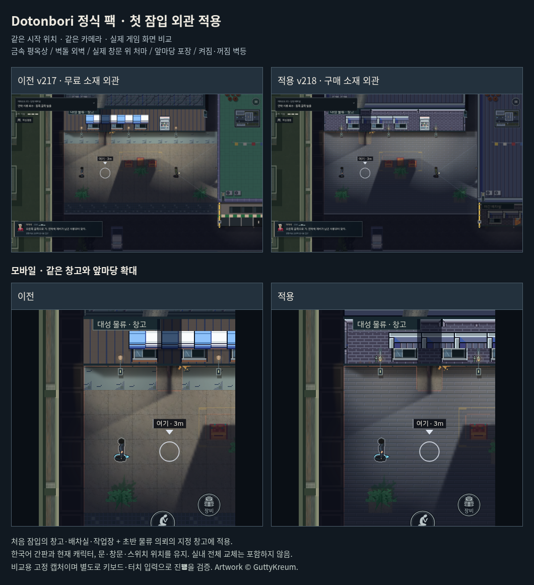

# Dotonbori 정식 구매 소재 외관 적용 · v218

첫 잠입의 창고·야간 배차실·수리 작업장을 GuttyKreum Dotonbori City의 벽돌 외벽, 금속 처마, 평옥상과 창틀로 마감한다. 첫 앞마당과 보도도 같은 팩의 포장으로 교체한다. 초반 물류 의뢰 `p0`, `p1`, `p2`, `e1`, `e2`의 지정 창고에는 같은 외벽·옥상 소재를 공유한다. 한국어 간판과 현재 캐릭터를 유지한다.

실제 문·창문을 따라 프레임과 차양을 배치한다. 창틀 안은 투명하게 조립해 기존 유리, 잠금, 개방 및 실내 빛이 그대로 보인다. 벽등은 실제 `lampOn` 상태에 맞춰 점등/소등 그림을 선택한다. 광원·스위치·회로·충돌·입력·AI·목표 조건은 변경하지 않는다. 옥상은 불투명하며, 옥상 시설과 계단 출입구도 기존 위치를 유지한다.

지붕은 구부러진 무늬와 경사 지붕 대신 곧은 금속 이음새를 선택하고, 가장자리/모서리/중앙을 별도로 타일링한다. 원본을 늘이지 않고 구조는 정수 2배, 포장과 등 머리는 정수 1배로 그린다. 바닥은 인물과 상호작용 표시보다 튀지 않도록 대비를 줄이고 야간 명도를 맞춘다. 새 소재가 늦게 로딩되면 지도·층·옥상 캐시를 갱신하고, 실패하면 기존 무료 소재로 복구한다. 기존 외관 렌더링에 통합해 별도 맵이나 새 기능을 추가하지 않는다.

이번 범위는 외관이다. 별도 유료 실내 팩이나 캐릭터 팩을 구매/적용한 것으로 취급하지 않는다. 원본 ZIP, 전체 타일맵, Unity 패키지 및 샘플 지도는 비공개 저장소 밖에 보관한다. 정식 원본 해시를 확인한 변환 도구로 게임에 쓰는 10개 프레임만 조립한다. 기존 무료 자판기 1개는 출처를 구분한다. 선택 소재는 CC0가 아니며, `src/art/dotonbori/LICENSE.txt`와 게임 크레딧에 권리·사용 조건을 기록한다.

## 검증

- 빌드 파이프라인 8개와 물리 상호작용 상태 검사 20개 그룹 통과.
- 소재/로딩 복구, 실제 창문 시야, 지붕 불투명, 층 가림, 조명 스위치, 실내 마감, 주인공 동작, 누적 의뢰, 조작 공간, 매달림, 옥상 경로, 높이 표시, 카메라, 가독성 관련 회귀 14개 통과.
- 소재 검사는 PC, 세로/가로 터치 화면에서 10개 프레임이 실제 그리기에 쓰이는지 확인한다. 실제 소등 뒤 차양 밝기가 119 → 54.7로 감소하며, 외관 그리기가 배우·지형·상호작용 상태를 변경하지 않는다. 지정된 다음 의뢰에는 벽/옥상이 적용되고 첫 앞마당 포장은 새어나가지 않는다. 구매 이미지 실패 시 무료 소재 복구도 확인한다.
- 일반 RAF/AI에서 첫 잠입 `tB`와 첫 암살 `p0`를 키보드 및 CDP 터치 입력으로 각각 완료했다. 모두 체력 3, 발각 0. 알려진 경로의 개발자 재생이며 초보자 이해도 조사나 물리 iPhone 성능 검증과 구분한다. 재생 기록은 `opening-*.json`, `contract-*.json`에 보관한다.

비교 이미지는 같은 시작 위치·카메라의 실제 게임 렌더링이다. 모바일 확대는 원본 화면 일부를 잘라 보여 준다. AI 생성 시안이 아니다.

