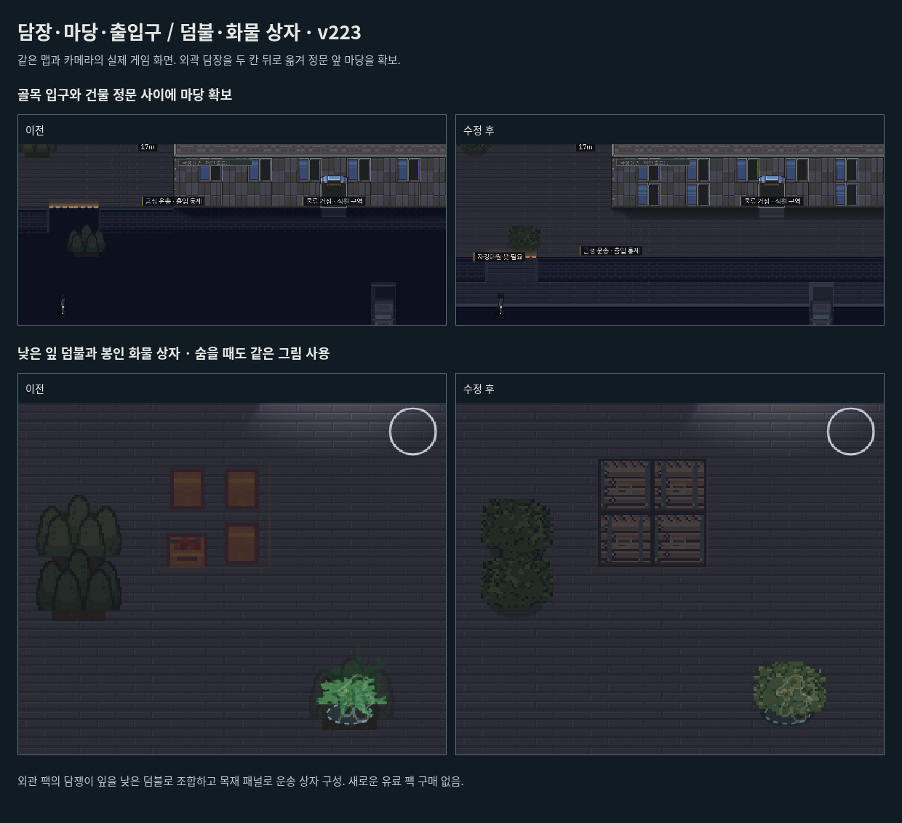

# 담장·마당·출입구와 야외 소품 · v223

문 그림을 드러내는 것만으로는 입구를 이해하기 어려웠다. 금성 운송의 정문 바로 앞칸이 외곽 담장이라 실제 정문 접근까지 막혀 있었다. 좁은 틈으로 보이던 단지 입구와 건물 문을 별개 공간으로 정리한다.

## 공간

- `p0`, `p1`, `p2`, `e1`의 남쪽 외곽 담장을 두 칸 뒤로 옮겨 정문 앞에 깊이 96px의 보행 마당을 만든다.
- 골목 보도 → 담장 사이 입구 → 마당 → 차양이 있는 건물 정문 순서로 이어진다. 두 칸 폭의 단지 입구는 유지하고, 시작 위치는 새 담장 바깥 골목으로 옮긴다.
- 마당의 출입 권한 경계도 새 담장 안쪽으로 맞춘다. 정문과 서쪽 옆문, 실내·계단·표적 배치는 유지한다.
- 배치 변경은 위 네 맵에 한정한다. [나머지 23개 맵의 공간 해시](layout-comparison.json)는 v222와 동일하다. 네 맵의 오래된 중간 저장은 기존 배치 버전 갱신 절차로 재시작되며 완료 보상은 보존한다.

## 덤불과 상자

기존 덤불은 나무 잎 부분을 여러 번 겹쳐 작은 침엽수 덩어리처럼 보였다. 숨은 플레이어 위에 예전 키트의 풀숲을 다시 그리는 별도 경로도 있어, 가까이 가면 그림 자체가 달라졌다.

- 나무 꼭대기 조합을 없애고 구매 팩의 작은 담쟁이 잎으로 낮고 넓은 녹색 덤불을 만든다. 네모난 흙 타일 대신 주변 바닥을 이어 그린다.
- 플레이어 앞뒤의 덤불은 같은 그림을 쓴다. 나무의 추가 가림 패스도 현재 나무 그림으로 통일한다.
- 과일이 담긴 낡은 상자는 구매 팩의 목재 패널로 조합한 봉인 화물 상자로 바꾼다. 모서리 철물·끈·작은 종이 라벨을 더한다. 야외 `C` 장애물과 실내 `boxes` 가구 모두 같은 계열을 쓴다.
- 숨기, 몸 숨기기, 잎 흔들림, 충돌과 조명 판정은 유지한다.

**도톤보리 팩에 완성된 화물 상자나 독립된 풀숲 스프라이트가 있었던 것은 아니다.** 보유 팩의 잎·목재 원본 픽셀로 게임용 조합을 만들었다. 같은 작가의 내부 가구 팩도 자동 배치나 조명 마감을 대신하지는 않는다. 이번 수정에는 추가 구매가 없다.

[출처·원본 선택 영역·조합 방식](../../src/art/dotonbori/exteriors.json) / [가져오기 도구](../../tools/import_dotonbori_exteriors.py) / [구매 자산 라이선스](../../src/art/dotonbori/LICENSE.txt)

## 검증

- [공간·소품 회귀](rules.json): 네 맵의 정문 앞 두 칸이 실제로 통과 가능하고, 시작 골목에서 담장 입구를 거쳐 정문까지 연결된다. PC·모바일에서 숨기 판정, 플레이어 앞뒤 덤불 그림과 렌더링의 판정 불변성을 검사한다.
- [전 맵 외관](coverage.json): 27개 맵의 새 외관과 102동의 불투명 지붕, 실제 옥상 장애물을 확인한다.
- 외관·문·층·조명·스위치·몸 숨기기·옥상 동선·임무 진행·카메라 등 집중 회귀 18개, 빌드 검사 8개와 물리 상태 검사 20개 그룹을 통과했다.
- [실제 입력 재생](native-summary.json): 첫 잠입 `tB`, 첫 암살 `p0`, 조명 미션 `p1`을 PC 키보드·CDP 모바일 터치로 각각 완료했다. 총 6회 체력 3·발각 0. `p0`는 새 마당과 정문을 반드시 통과한다. 배우·AI·체력·게임 시간을 덮어쓰지 않는 알려진 경로 재생으로, 초보자 조사나 물리 iPhone 검증은 아니다.
- 모바일 첫 시도에서는 이동 중 표적이 공격 범위를 벗어나 재생기의 대기가 시간 초과됐다. 실제 입력을 해제하고 재접근하는 제한된 재시도를 재생기에 추가한 뒤 두 의뢰를 재검증했다. 게임 판정을 바꾸어 통과시키지 않았다.
- 배포 패키지의 PC·모바일 이동, 메뉴·목표 정지/복귀, 한국어 폰트, 브라우저 리소스 해시 12개를 확인했다.

아래는 동일한 맵·카메라의 고정 렌더링 확대 비교다. 실제 입력 재생 기록과 구분한다.

