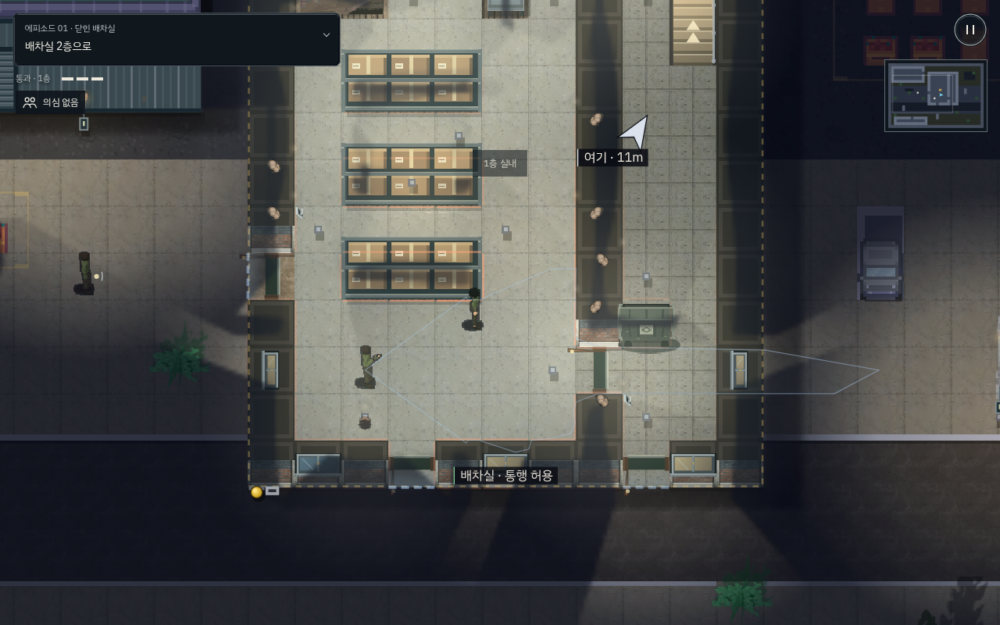

# 첫 잠입과 초반 의뢰의 사건·공간 정리 · v214

기존 선형 에피소드와 규칙 위에, 배운 행동이 실제로 통하는 장면과 관찰할 수 있는 표적의 일과를 더했다. 유료 에셋은 아직 구매하거나 적용하지 않았다. 한국의 가상 물류 골목·금성회·올빼미와 까마귀 설정을 유지한다.

## 플레이 변화

| 구간 | 이번에 다듬은 내용 |
| --- | --- |
| 닫힌 배차실 | 처음 경비는 혼자 둔다. 기절 → 옷 → 몸 숨기기 뒤, 안쪽 직원이 허용 복장을 실제로 보고 야근 동료로 받아들인다. 까마귀가 통행 성공을 짧게 확인한다. 직원 제압이나 응답을 승리 조건으로 추가하지 않았다. |
| 닫힌 철문 | 마당·1층·2층의 세 만남을 유지한다. 박인호가 통화 자리와 보고 자리를 오가며 접근 기회를 만든다. 사무동의 대기 소파와 배차 현황판을 정리했다. |
| 불 꺼진 출고동 | 기존 스위치·복구 경비·두 표적을 유지한다. 출고 상자와 적재 표시를 배치하고 한재문의 업무 동선을 더했다. |
| 야간 기록실 | 서류장과 선반을 배치하고 차유진이 두 업무 자리를 오가게 했다. 기존 소등·은폐·두 표적 처치·명세서 회수는 그대로 활용한다. |
| 녹화된 얼굴 | 감시용 PC와 서류장을 배치하고 정하린의 업무 동선을 더했다. 서류는 책상에 고정해 새 PC 때문에 회수 위치와 카메라 보호 대상이 달라지지 않게 했다. |
| 지붕 위의 장부 | 기존 창문·3층·옥상 점프·낙하 간판·장부 회수의 누적 공략을 유지하고, 앞선 의뢰와 함께 PC·터치 재생으로 확인했다. 이 의뢰의 새 에셋 교체는 포함하지 않았다. |

표적의 업무 자리는 기존 순찰·경로 탐색·시야·성격 행동을 사용한다. 긴 대기 구간을 두어 첫 암살에 짧은 타이밍 입력을 강요하지 않는다. 다른 해결 방법을 막거나 모든 경비 처치를 요구하지 않는다. 스킬은 기존대로 완료 보상 1P, 스테이지 밖 준비 화면에서 배운다.

## 환경 표현

- 첫 배차실의 슈퍼마켓 냉장고를 물류 상자와 사물함으로 교체했다.
- 창고 선반은 직접 그린 픽셀 택배 선반으로 바꿨다. 철제 프레임·종이 상자·테이프·배송 라벨을 표현하되 선반의 기존 충돌·엄폐 크기를 유지한다.
- 적재 구획과 벽 현황판은 지도와 함께 구워 그린다. 새 버튼·콜라이더·목표 표식으로 사용하지 않으며 조명·지붕·층 가림을 함께 받는다.
- 미션별 건물 이름과 내부 소품을 실제 업무 용도에 맞췄다. 새 패널·대화 중 강제 정지·반복 팝업은 추가하지 않았다.
- 배치 개정 214 이전의 진행 중 체크포인트는 해당 의뢰를 새로 구성한다. 완료 기록과 획득 포인트는 보존한다.

## 구매 예정 소재를 받을 때

Dotonbori 외부와 Office 내부는 기존 문·계단·창문·가구의 물리 앵커에 맞춰 교체한다. 일본어 광고와 강한 지역 상징은 한국어 물류·공구·인쇄 골목 간판으로 바꾼다. 32px 원본과 현재 48px 물리 칸의 관계는 샘플 방에서 먼저 검증하며, 일괄 1.5배 확대를 완성안으로 취급하지 않는다. 기존 캐릭터의 8방향 동작을 유지하고 원본 유료 PNG/ZIP은 공개 저장소에 넣지 않는다.

## 검증

`first_steps_live.py`는 처음부터 키보드/CDP 터치로 소등 샛길 → 기절 → 변장 → 은폐 → 직원 앞 평범한 걷기 → 2층 회수 → 탈출 → 다음 출발을 수행한다. 일반 RAF/AI를 유지하며 배우·시계·체력을 덮어쓰지 않는다. 이미 경로를 아는 자동 재생으로, 처음 하는 사람의 재미나 이해도를 입증하는 실험은 아니다.

`compound_live.py`는 초반 다섯 의뢰의 알려진 경로를 실제 입력으로 수행한다. 별도 상태 고정 회귀는 업무 경로의 도착 지점·실제 이동, 복장 허용/비허용 응답, 스위치 복구, 카메라의 서류 감시, 전선과 기록 삭제의 차이, 옥상/간판 및 저장 호환을 검증한다. 실제 스마트폰의 성능·햅틱 검증과는 구분한다.

위 이미지는 환경과 레이어 확인을 위한 고정 장면이다. 네이티브 입력 플레이의 증거 이미지와 구분한다.
