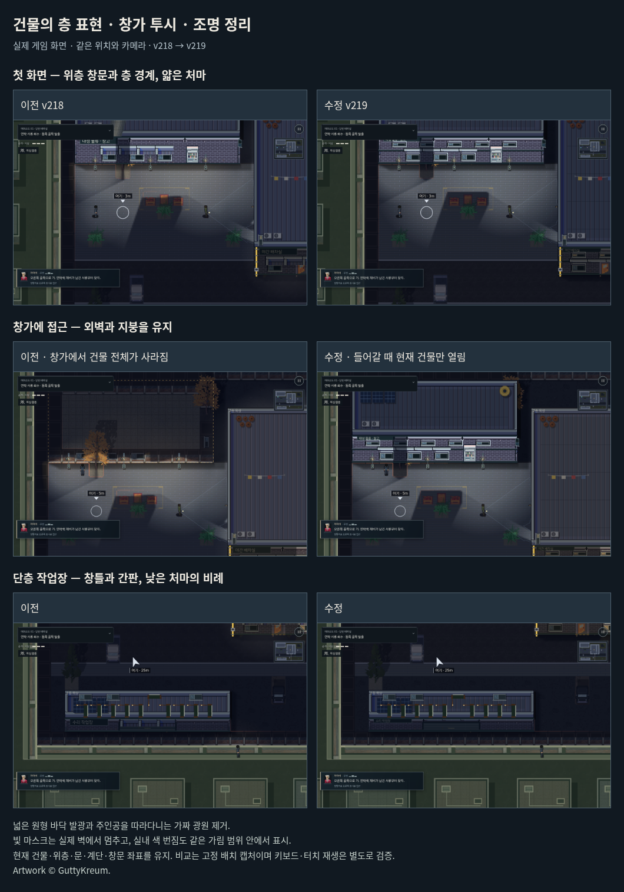

# 건물의 층 표현 · 창가 투시 · 조명 정리 · v219

v218은 구매 소재를 적용했지만, 2층 창고에도 창문 한 줄만 그렸다. 두꺼운 차양과 큰 간판이 짧은 벽 높이를 차지해 건물이 납작하게 읽혔다. 창가에서는 플레이어 상태가 건물 전체의 지붕을 열고, 별도의 자동 시야가 실내 평면을 겹쳐 그렸다. 조명에는 가림 마스크와 별개인 넓은 가산 발광, 주인공을 따라가는 밝은 원, 첫 벽을 20px 넘어가던 마스크가 공존했다.

## 변경

- 실제 위층 창문 목록을 해당 외벽의 층에 맞춰 그린다. 위층 창문은 해당 층 조명과 창짝/잠금 상태를 반영한다. 기존 층수·지형·창문·문·계단 좌표를 유지한다.
- 층 경계와 기단을 구분하고 차양을 얇은 금속 처마로 바꾼다. 간판을 낮추고 단층 간판 폭을 실제 창문 앞의 빈 폭에 맞춘다. 큰 평옥상에는 얕은 패널 이음을 넣는다.
- 창가 접근으로 건물 전체를 여는 처리, 자동 실내 도면/시야 중첩과 해당 안내·전용 조건을 삭제한다. 실내로 진입하면 현재 건물이 열리는 기존 전환과 직접 누르는 살피기는 유지한다. 옛 저장의 `peek` 값은 지붕을 열지 않는다.
- 실외 바닥의 중복 원형 발광, 주인공을 따라다니던 가짜 광원과 클럽 입구의 고정된 빛 쐐기를 제거한다. 전체 암부를 조금 들어 올려 통로 가독성을 유지한다. 실내 색 번짐은 약하게 하고 실제 빛 다각형 안에서만 표시한다.
- 네 곳의 빛 다각형 생성을 한 함수로 통합하고 첫 가림 벽에서 멈추게 한다. 기존 저장을 불러올 때도 시각 마스크를 재생성하고 캐시를 갱신한다. 광원·회로·스위치 위치와 `lightAt/los`에 의한 감지 판정은 유지한다.
- 전용 실내 발광 렌더러를 공통 렌더러로 통합하고, 자동 투시 전용 함수와 지붕 발광 억제 조건을 삭제한다. 정식 소재 원본을 새로 공개하지 않고 게임용 창틀 조립 한 개를 더해 현재 선택 프레임은 11개다.

이번 수정은 원근 투영이나 엔진 교체가 아니다. 현재 2D 격자 위에서 층·개구부·광원의 원인과 결과가 일관되게 보이도록 정리한 것이다. 창문 근처의 자동 실내 관찰 기능은 삭제했으며, 직접 살피기와 진입 후 실내 표시가 현재 제공되는 방식이다.

## 검증

- 빌드 파이프라인 8개 및 물리 상호작용 상태 검사 20개 그룹 통과.
- 소재, 창가 지붕, 빛 표현, 기존 클럽 외관, 지붕 불투명, 층 가림, 조명 스위치, 실내 마감, 캐릭터 동작, 누적 의뢰, 조작 공간, 매달림, 옥상 경로, 높이 표시, 카메라, 가독성 회귀 16개 통과. 실제 배차실 도면의 표시/복원도 검사했다.
- 신규 빛 검사: 3개 스테이지에서 광선 2,760개 표본의 가림 범위를 확인했다. 실내 색 번짐의 벽 가림과 소등, 실외 중복 발광 부재, 주인공 이동으로 주변 밝기가 변하지 않음, 감지 밝기 유지(소등 지점 0.04), 구버전 저장의 마스크 수리와 소등/고장 상태 유지가 통과했다.
- 소재 검사: PC/세로·가로 터치에서 11개 소재 사용, 실제 위층 창문 좌표 및 개수 일치, 층 복원, 실제 소등 반응, 다운로드 실패 시 무료 소재 복구를 확인했다.
- 일반 RAF/AI에서 `tB` 및 `p0`를 키보드와 CDP 터치 입력으로 각각 완료했다. 모두 체력 3, 발각 0. 알려진 경로의 개발자 재생이며 초보자 조사나 실제 iPhone 성능 검증과 구분한다. `opening-*.json`, `contract-*.json`에 보관했다.

비교 화면은 동일 난수·위치·카메라로 고정 배치해 실제 게임 렌더러를 캡처했다. 자동 창가 처리는 실제 플레이어 갱신을 호출하고 충분히 정착한 뒤 캡처했다. 이러한 비교 배치는 별도 native 입력 재생과 구분한다.

