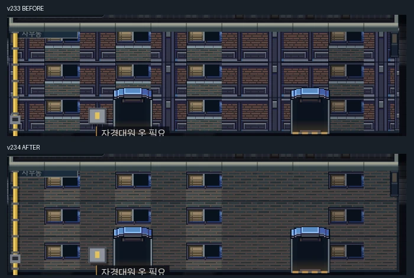

# 창문과 외벽 재질 혼합 수정

클럽 의뢰의 사무동 외관에서 재현했다. `cityBuildingStyle`은 green을 선택했지만 벽은 갈색 `brickStorey`로 그렸고, `greenWindow`에는 녹색 벽돌이 포함돼 있었다. 창문마다 다른 벽 재질이 수직 패치처럼 반복됐다.

해당 외관은 구매 팩의 `wallGreen`을 원래 픽셀 배율로 연속 타일링하고 창문은 원본 타일 위쪽의 창틀 부분만 그린다. 갈색 벽돌 무늬 위에 녹색 벽 조각을 덧붙이지 않는다. 다른 외관 유형, 문 좌표, 창문 통과·잠금, 방별 조명 및 충돌 데이터는 유지한다. 입구 두 개는 실제 문 두 곳이며 장식 복제 문이 아니다.

PC에서 같은 사무동 위치를 비교했고 공개 캠페인의 해당 스타일 건물 목록을 확인했다. PC·터치 출입구/문턱 회귀 검사와 9개 에피소드의 실제 방 조명·창문 상태 검사, 빌드 파이프라인 8개 검사를 통과했다. v233에서 추가한 스페이스바 출발은 두 공개 주소의 PC 입력 및 모바일 탭으로 확인했다.
