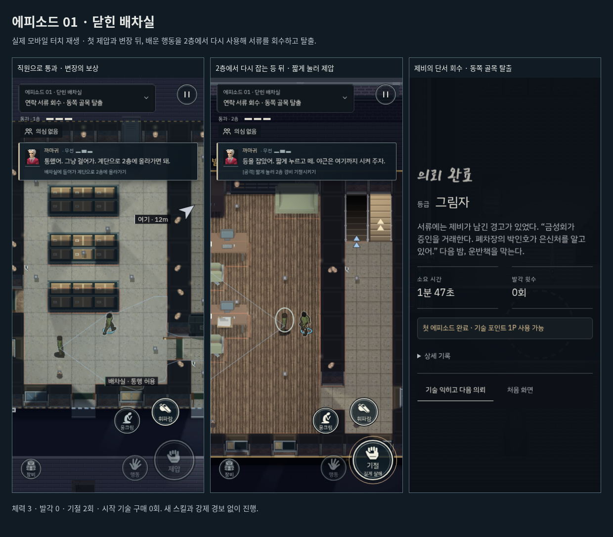

# 에피소드 01 · 닫힌 배차실 · v224

첫 에피소드는 사라진 연락책 제비의 서류를 빼내는 잠입 의뢰다. 기존에는 밖의 경비를 한 번 제압한 뒤 2층의 서류를 가져오는 데서 끝나, 배운 행동을 스스로 다시 활용하는 구간이 부족했다.

## 경험의 흐름

1. 까마귀가 올빼미를 이름으로 부르고, 제비의 연락이 끊겼다는 목적을 전달한다. 기존 이동·웅크리기·첫 제압의 안전한 동선을 유지한다.
2. 경비에게서 옷을 얻고 몸을 숨긴다. 배차실 직원이 실제 시야로 통행을 허용하며 말을 건다. 변장이 통했다는 보상이 다음 진입으로 이어진다.
3. 2층에서는 서류를 보는 경비 한 명을 만난다. 복도 끝의 실제 문을 거쳐 등 뒤로 접근하도록 안내한다. 아래에서 익힌 짧은 공격을 다시 사용할 수 있다.
4. 기절시키면 안내가 서류로 전환된다. 조명을 끄고 시야를 피해 서류를 챙겨도 완료할 수 있다. 경비 처치는 필수 목표가 아니다.
5. 제비의 연락 서류에서 박인호·금성 운송이라는 다음 의뢰의 단서를 얻고 동쪽 골목으로 탈출한다.

야외 경비·1층 직원·2층 경비는 서로 다른 구역에 배치한다. 새로운 조작, 강제 경보, 제한 시간이나 구매 기술을 요구하지 않는다. 처음의 안전한 제압 뒤에 고립된 상대를 한 번 더 공략할 기회를 둔다. 이것은 이용자 조사로 재미를 입증했다는 뜻이 아니라, 실제 플레이에서 행동을 활용할 구간을 보완한 설계다.

## 판정과 표현

- 새 경비는 실제 시야·조명·목격 판정을 사용하는 일반 NPC다. 같은 직원 복장으로 걷는 것은 허용하고, 눈앞에서 서류를 훔치는 행동에 반응한다.
- 안내는 벽 너머를 곧장 가리키지 않는다. 복도 아래 → 사무실 문 → 경비 뒤쪽 순서로 바뀐다. 화면 밖 목표는 기존 가장자리 화살표를 사용한다.
- 은신처로 들어가거나 몸을 든 채 서류를 챙기려 하면 먼저 나가기·손 비우기 안내를 준다. 경비가 깨어나거나 이미 서류를 얻은 경우에도 현재 상태를 기준으로 진행한다.
- 까마귀의 짧은 대사를 상황에 맞춰 바꾼다. “우리도 출근해 볼까”, “야근은 여기까지 시켜 주자”처럼 진행에 필요한 정보 안에서 성격을 드러낸다. 신규 대사 창은 만들지 않는다.
- 체크리스트가 넘어갈 때의 반복 스위치 소리를 이야기 에피소드에서 제거한다. 실제 제압·옷·몸 숨기기·서류 획득 소리는 유지한다.
- **첫 완료에 잘못 표시되던 ‘포인트 중복 지급 없음’을 수정한다.** 첫 에피소드 완료에는 준비된 기술 포인트 1P가 사용 가능함을 표시한다. 시작 예산이나 실제 지급량을 늘리지 않는다. 재플레이에는 추가 포인트를 지급하지 않는다.
- 배치 버전 224로 오래된 첫 에피소드 중간 저장을 갱신한다. 기존 완료·기술 보상 기록은 보존한다.

## 검증

- [첫 에피소드 규칙](rules.json): 일반 통행과 실제 절도 목격, 물리 조명으로 조용히 회수하는 경로, 모든 경비가 살아 있어도 열리는 탈출, 체크포인트, 실제 문을 거치는 안내와 첫 완료 1P 표시를 검사했다.
- 이야기·모바일 무전 배치·변수 대응·목표 표시·스킬 준비·기존 첫 의뢰·조명·외관·상호작용 등 집중 회귀 19개를 통과했다. 기존 `t_first_night.py`는 보존하고 새 첫 에피소드 검사는 `t_opening_episode.py`로 추가했다. 빌드 검사 8개와 물리 상태 검사 20개 그룹도 통과했다.
- [키보드·터치 재생 요약](native-summary.json): 두 플랫폼 모두 첫 제압·옷 훔치기·몸 숨기기·변장 통과·2층 재제압·서류 회수·계단 복귀·탈출을 완료했다. 체력 3·발각 0·기절 2회·구매 기술 0개. 첫 완료 화면의 1P 표시와 다음 출발 전 기술 화면도 확인했다.
- 이전 버전을 실제 키보드 입력으로 완료한 [이전 PC 기록](before-pc.json)을 기준으로 검토했다. 새 버전의 입력 재생은 배우·AI·체력·게임 시간을 변경하지 않는 알려진 경로이며, 초보자 이해도 조사나 물리 iPhone 시험과 구분한다.
- 모바일의 화면 밖 목표는 원형 표식 대신 가장자리 화살표로 정상 표시된다. 테스트는 그 경우를 구분하며, 기존 화면 안 이동 표식 검사는 유지한다.

아래 이미지는 실제 입력 재생 중의 화면이다.

