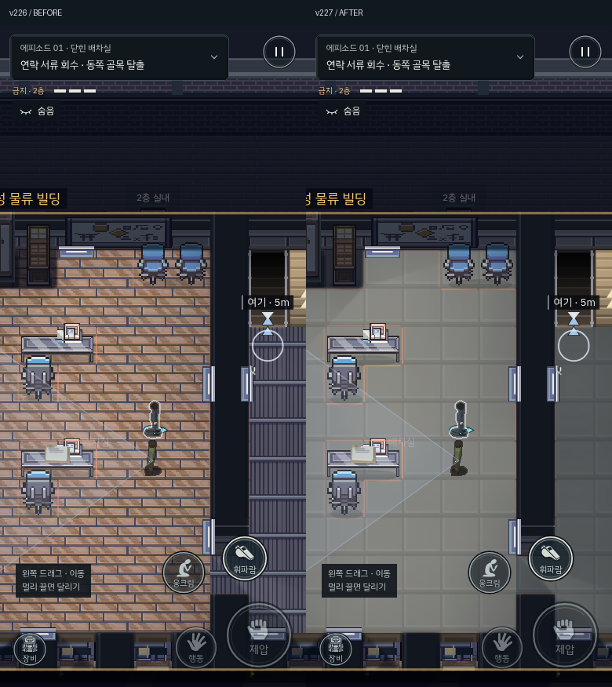
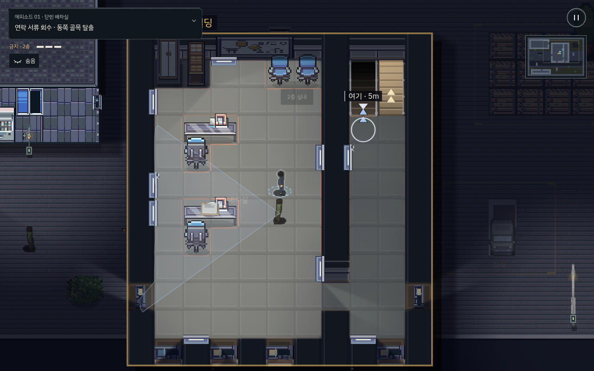
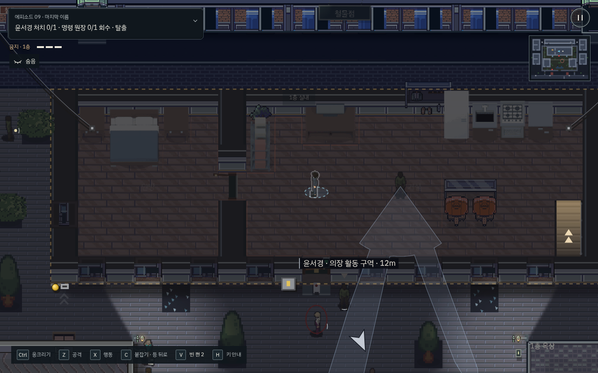

# v227 · 차분한 업무 공간 바닥

사무실까지 밝은 쪽매무늬를 촘촘히 반복해 작은 화면에서 바닥이 인물·서류보다 먼저 보였다. 복도와 배차 공간에 쓰던 줄무늬도 격자 철판처럼 보였다.

- 기록실·문서 보관실은 무광 회색 타일, 간부 사무실은 밝은 중성색 타일로 바꿨다.
- 배차·거래 업무 공간은 줄무늬 대신 낮은 대비의 청회색 카펫 타일, 창고·복도·감시실은 짙은 타일을 사용한다.
- 구매한 Office Interior의 타일 한 장을 바탕으로 색을 조정했다. 한 게임 셀에 작은 판 네 개가 들어가던 반복을 큰 타일 한 장으로 바꿨다. 줄눈과 모서리의 밝기 차도 줄였다.
- 사저·주거 공간·클럽 라운지에는 목재를 유지하되 나뭇결 대비를 55%로 낮췄다. 원본 ZIP과 전체 타일맵은 계속 비공개다.

## 검증

- 공개 9개 에피소드의 지형·가구 충돌·경비·조명·계단·아이템·수납·탈출 데이터 해시는 v226과 동일하다. `coverage.json`에 기록했다.
- PC/모바일에서 기록실·배차 공간·간부 사무실·사저를 동일한 위치와 조건으로 전후 촬영했다. `visual-review.json`은 장면 검수용 위치이며 미션 완주 기록은 아니다.
- 9개 에피소드 실내 아트 검사, 기본 스위치·회로·복구 반응 검사, 수납장 조명 일관성 검사, 빌드 파이프라인 8개 검사, 물리 상호작용 20개 검사를 통과했다.

- 실제 키보드·터치 입력으로 첫 에피소드의 제압 → 변장 → 몸 숨기기 → 2층 진입 → 서류 회수 → 탈출을 모두 완료했다. 양쪽 모두 체력 3, 발각 0이었다. 기존 경로를 아는 개발자 재생이며 초보자 사용성 시험은 아니다.
- 패키지의 PC/터치 이동·웅크리기·메뉴·일시정지·한글 폰트·12개 배포 파일 해시 검사를 통과했다.
