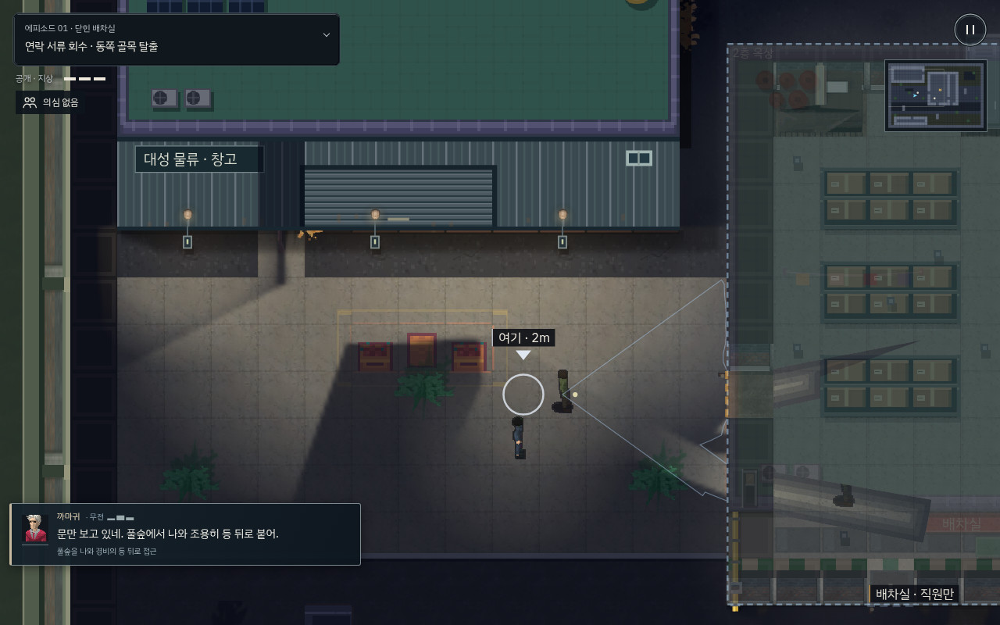
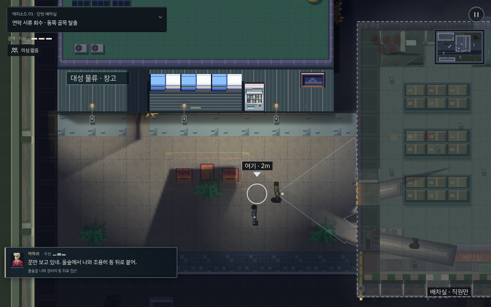
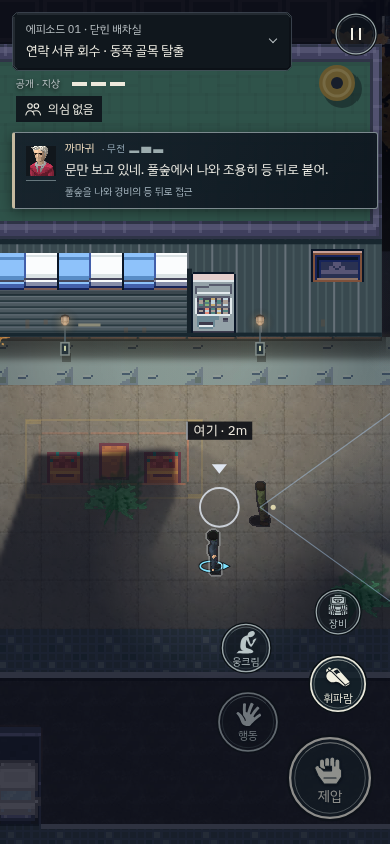

# 공식 무료 City 팩 · 첫 골목 시범 적용 · v216

GuttyKreum의 [Japanese City 무료 버전](https://guttykreum.itch.io/free-japanese-city-game-assets)을 공식 무료 다운로드로 받아, 첫 에피소드의 창고 앞 골목에 적용했다. 결제는 하지 않았다. 유료 Dotonbori/Office의 원본이나 동봉된 유료 버전 미리보기 그림은 사용하지 않았다.

## 선별과 배치

차양·가로형 창·벽면 자판기·아스팔트·보도 소재 다섯 개를 선별했다. 바닥을 촘촘한 보도 패턴으로 모두 바꾼 초기안은 인물·시야 판독을 방해해 제외했다. 중앙 마당의 기존 바닥을 유지하고, 새 바닥은 창고 바로 앞과 골목 가장자리에 한정한다. 자판기는 출입 셔터와 실제 조명/스위치를 피해서 벽면에 배치했다. 가구와 실제 램프가 겹친 벤치 시험안도 제외했다.

일본어 표지와 강한 전통 건축 상징은 이번 선별에 넣지 않았다. 기존 한국어 물류 간판을 사용한다. 32px 원본은 2배 정수 크기로 그린다. 24px 보도 부분은 48px 물리 칸에 맞고, 32px 아스팔트는 64px 패턴을 물리 칸 경계에서 잘라 그려 1.5배 확대를 피한다. 소품도 2배이며 캐릭터의 8방향 동작을 유지한다.

새 이미지는 기존 지도/외벽 렌더 경로에서 그려져 실제 조명과 층/지붕 가림을 받는다. 자판기는 벽면 장식이며 구매나 아이템 획득 기능을 뜻하지 않는다. 첫 에피소드만 적용하고, 공유 원형을 복사한 다른 에피소드에 시범 설정이 상속되지 않도록 모든 에피소드 구성 후 설정한다.

## 출처와 다음 판단

원본 ZIP·전체 타일맵은 비공개 보관한다. 게임에 쓰는 선별 아틀라스만 포함하며 [공식 사용 조건](../../src/art/gutty-city/LICENSE.txt)과 출처를 기록했다. 무료는 CC0를 뜻하지 않으며 게임 밖으로 별도 추출·재사용·재배포하는 권리를 제공하지 않는다.

`tools/import_gutty_free_pilot.py`는 공식 Free v1 타일맵의 SHA-256을 확인하고 선택 부분을 재현한다. 원본 위치를 인자로 제공해야 하며 빌드에 원본 전체나 외부 다운로드를 요구하지 않는다.

이번 무료팩은 거리와 외관을 판단하는 단계다. 실내 가구·스위치·창문 열림/잠금 동작의 전체 구성을 제공하거나 검증한 것으로 취급하지 않는다. 외관의 실제 화면을 보고 통과한 범위부터 넓히며, 유료 구매는 보류한다.

## 검증

- 빌드 파이프라인 8개 통과.
- `t_free_city_pilot.py`: PC/세로·가로 터치에서 선별 이미지 다섯 개의 실제 캔버스 사용, 렌더링 전후 충돌·배우·조명 스위치·진행 상태 보존, 다음 의뢰로의 시범 이미지 누출 방지를 검사한다. 실제 스위치를 내리면 차양 밝기가 약 114→75로 낮아진다.
- 무전·화면 공간·레이어·지형 정렬·방 스위치·진행 안내·주인공 동작·의뢰 인물·실내 조명 관련 회귀 10개 통과. 무전 v215는 앞서 전체 빠른 회귀 109개와 실제 입력 재생을 통과했다.
- `first_steps_live.py`: 첫 에피소드를 키보드/CDP 터치로 각각 완료, 체력 3·발각 0. 일반 RAF/AI를 사용하며 배우·시계·체력 덮어쓰기를 하지 않는다. 알려진 경로의 개발자 재생으로 초보자 이해도나 실제 휴대폰 성능 검증과 구분한다.

아래 이미지는 비교를 위해 같은 카메라/장면을 고정한 캡처다. 실제 입력 재생 증거와 구분한다.

