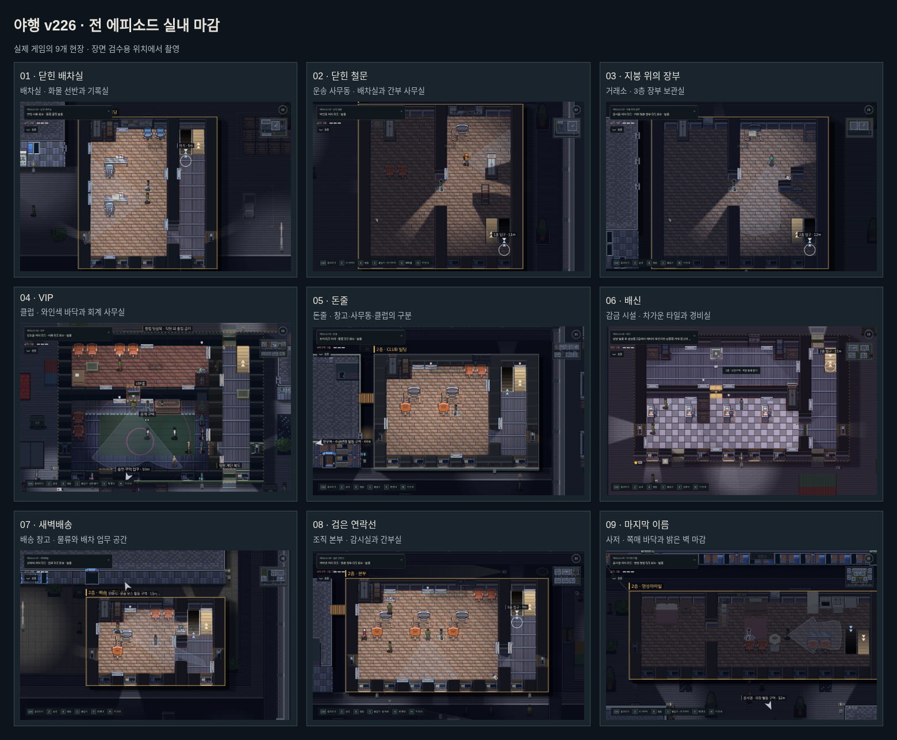
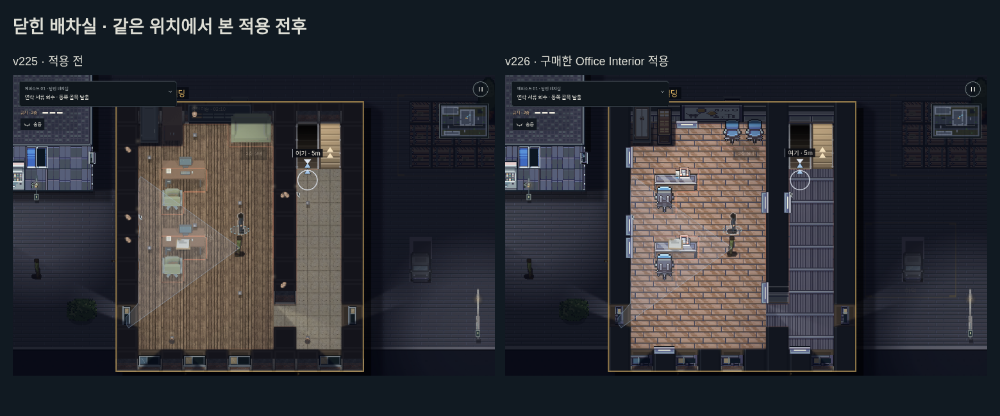

# 야행 v226 · 공개 9개 에피소드 실내 마감

구매자가 제공한 **GuttyKreum Japanese Office Interior v3**를 공개 캠페인 9개 의뢰에 적용했다. 현재의 2D 게임·도톤보리 외관·주인공과 주요 인물·단서 진행을 사용하는 플레이 가능 빌드다. 각 현장의 용도에 따라 바닥·벽·사무 가구·조명 프레임을 선택했다.

## 장소별 구성

| 의뢰 | 마감 방향 |
| --- | --- |
| 닫힌 배차실 | 화물 선반과 하역 구역, 배차 사무실, 나무 바닥의 2층 기록실. 첫 제압·변장·몸 숨기기·서류 회수 경로를 유지한다. |
| 닫힌 철문 | 1층 배차 공간과 2층 간부 사무실을 구분한다. 서류장·임원 책상·가죽 의자를 사용한다. |
| 지붕 위의 장부 | 정비동의 차가운 바닥, 거래소의 업무층·감시층·3층 장부 보관실에 다른 마감을 적용한다. |
| VIP | 클럽의 와인색 쪽매 바닥과 따뜻한 조명 프레임, 별도 회계 사무실·숙소·욕실을 구분한다. |
| 돈줄 | 물류 창고·사무동·클럽·주거동에 각기 맞는 재료를 사용한다. |
| 배신 | 감금동의 타일, 감시 업무 공간과 숙소를 구분한다. |
| 새벽배송 | 화물 창고와 배송 사무실, 위층의 배차 업무 공간을 나눈다. |
| 검은 연락선 | 감시실과 간부 사무실을 차가운 색과 목재 마감으로 구분한다. |
| 마지막 이름 | 사저에 쪽매 바닥·밝은 벽·따뜻한 조명 프레임을 적용한다. 주변 숙소와 관리 공간에도 각각 적용한다. |

## 가구와 상호작용

- 원본 책상에는 의자가 포함된 형태가 있어, 원본 유리 테이블·모니터·전화기 부분으로 책상을 조합하고 게임의 별도 의자를 사용한다. 동일한 자리에 의자가 겹치지 않는다.
- 실제 서류·메모·단말의 표시 좌표를 새 책상 그림에 맞춘다. 기존 책상 앞에서 읽기·회수 판정을 받을 수 있는 논리 좌표를 유지한다.
- 수납장 문에 구매한 픽셀을 적용하며 기존 손잡이 접촉·열기·몸 이동·닫기 순서를 유지한다. 단순한 정적 그림으로 바꾸지 않는다.
- 화물 선반은 화물 선반으로 유지한다. 구매 팩에 없는 전용 침대·욕실·주방·금고는 기존 기능에 맞는 그림을 계속 사용한다. Office 팩만으로 모든 종류의 가구가 들어 있다고 주장하지 않는다.
- 바닥·벽·창틀·조명은 여러 에피소드에서 같은 미술 계열을 사용한다. 첫 에피소드의 하역·대기 구역은 지면 도색으로 표시하며, 통로에 장식용 장애물을 추가하지 않는다.

## 함께 수정한 문제

수납장·쓰레기통을 열 때 기존 동작 버퍼가 일반 지도보다 강한 조명 색을 다시 더하고 있었다. 일반 지도와 동작 버퍼가 같은 색·강도·가림 다각형을 사용하는 `drawLampTint`를 공유하도록 통합했다. 검사 지점의 동작 시작 전후 색상 차이가 약 16에서 최대 약 1.3으로 줄었고, 동작 중 캔버스를 매 프레임 할당하지 않는다.

구버전 저장의 화장실 광원을 복구할 때, 사용자가 서는 위치와 조명 설치 위치가 한 칸 달라 복구하지 못하는 문제도 수정했다. 같은 건물의 실제 실내 조명 정의를 찾아 복구한다. 몸·서류·자물쇠·학습 기록은 유지한다.

## 확인 범위

- [전체 적용 검사](coverage.json): 공개 9개 의뢰의 모든 층 타일·가구·경비·조명·계단·회수 물품·은닉처·출구를 미술 적용 전후 비교했다. 새 미술이 물리 배치를 변경하지 않는 것을 확인했다. 기본 스위치와 수납장 개방 그림도 검사했다.
- 집중 회귀 26개 및 신규 실내 검사 통과. 상호작용·시야·조명·방 스위치·은닉 동작·메모/식사·이야기·기술 준비·모바일 UI·외관·저장 등을 포함한다.
- 빌드 파이프라인 8개, 물리 상호작용 20개 그룹, 로컬 배포본 PC/모바일 이동·일시정지·폰트와 콘텐츠 해시 12개 검사를 통과했다.
- [실제 입력 재생 요약](native-summary.json): 첫 세 의뢰를 PC 키보드와 모바일 CDP 터치로 각각 완료했다. 체력 3, 발각 0. 지도 좌표를 읽는 개발자 경로 재생이며 배우·체력·AI·게임 시간을 조작하지 않는다.
- VIP는 완료 기록 2개와 그 예산으로 구매한 기술을 준비한 의뢰 선택 테스트에서 정상 RAF/AI·키보드로 완료했다. 체력 3·발각 0, 경보 3회. 카메라 전선을 발견한 경비와 몸 발견의 결과를 유지했으며 무경보 성공이라고 기록하지 않는다.
- 9개 의뢰의 PC·모바일 장면을 검수했다. 후반 5개 의뢰의 일반 입력 완주나 초보자 이해도 조사, 물리 iPhone 시험을 했다는 뜻은 아니다.

일부 오래된 검사는 현재 규칙에 맞게 시험 준비를 명시했다. 두 사람이 함께 들어가는 애니메이션은 용량 2와 이미 배운 기습을 가진 독립 시험 장면에서 검사한다. 실제 게임 은닉처의 용량 1이나 기술 학습 규칙을 바꾸지 않는다. 환풍구·지하도·간판은 임의의 예전 개수 하한 대신 현재 지도에 존재하는 전부를 검사한다. 이전 무료 실내 파일 검사는 해당 대체 그림을 명시적으로 선택해 유지한다.

## 구매 원본과 배포

공식 출처: https://guttykreum.itch.io/japanese-office-interior-game-assets

일반 v3 PNG에서 필요한 부분을 골라 게임용 60프레임 아틀라스로 구성했다. 원본 ZIP·전체 타일맵·개별 원본 모음·Unity 패키지는 저장소와 배포본에 포함하지 않는다. 원본 SHA-256·좌표·조합은 `src/art/office/interiors.json`, 조건은 `src/art/office/LICENSE.txt`, 재현 도구는 `tools/import_office_interiors.py`에 기록했다. 저작권은 GuttyKreum에게 있으며 게임 밖 재사용 권리를 제공하지 않는다.

