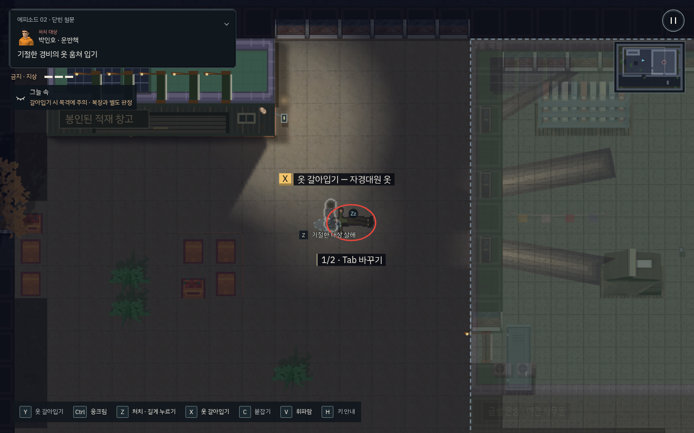
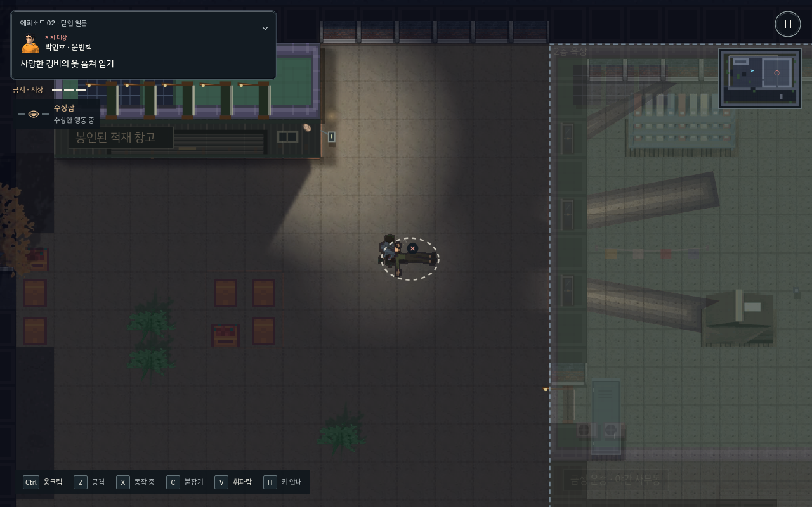
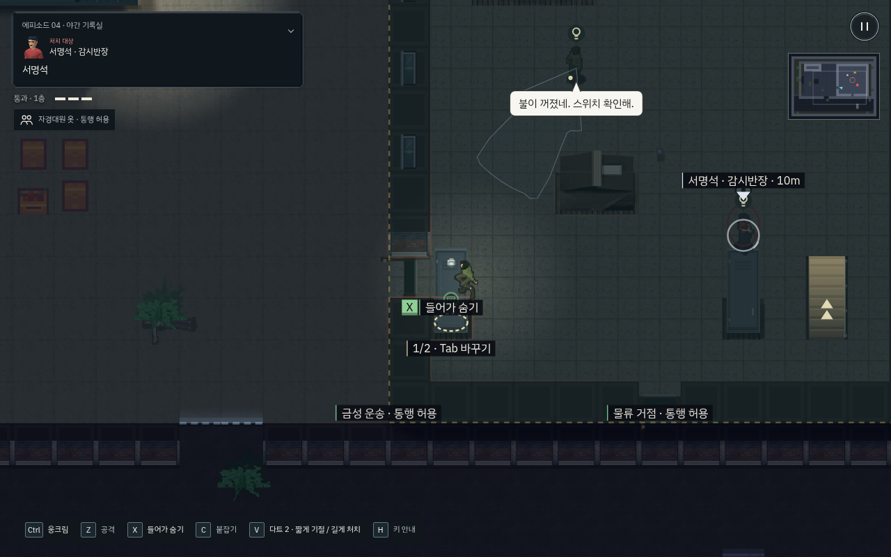
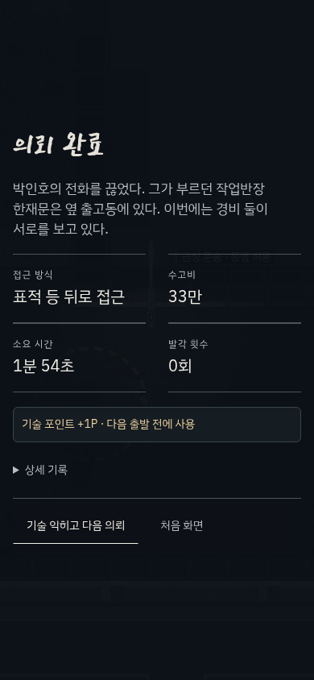

# 기존 행동의 원인·결과 마감 · v213

새 미션이나 기술을 추가하지 않고 기존 로직의 표현을 정리했다. 기준 검토는 [상용 마감 검토](../compound-v212/commercial-polish-review.md), 유료 소재의 재조사는 [에셋 후보](assets.md)에 있다. 유료 에셋은 구매·적용하지 않았다.

## 구현한 사건 흐름

| 사건 | 입력·준비 → 접촉·변화 → 결과·정착 | 강도 / 우선순위 |
| --- | --- | --- |
| 제압·살해 | 기존 눌림/접근/짝동작 유지 → 실제 접촉의 작은 효과 → 근처 몸의 `Zz`/사망 표시, 반복 설명 축약 | 중요 / P0 |
| 기절자 살해 | 유지 입력에 낮은 작업 준비 자세 → 1초 유지에서 기존 살해 확정 → 짧은 접촉·회복. 놓으면 취소, 이동 버퍼 유지 | 중요 / P0 |
| 운반·은폐 | 기존 들어올리기/걷기/가구 손잡이 접촉 → 몸 이동·수납 → 닫힘·정착 뒤 1회 영수증 | 일반~중요 / P0 |
| 변장 | 기존 노출 시간·옷 작업 → 복장 변경 → 현재 통행 권한 HUD의 작은 반응. 범죄 목격과 출입 허가는 별도 유지 | 중요 / P0 |
| 조명·조사 | 벽 스위치 접촉 → 담당 방 소등 → 복구자는 전구, 소리 조사자는 음파 표시. 실제 발각·기억된 얼굴 경고 우선 | 일반~중요 / P0 |
| CCTV | 수상한 행동의 실제 녹화 → 렌즈 REC·같은 원인 기록 → 전선 분리는 이후 촬영 중지, 관리 단말은 작업 완료에서 감시/기록 처리 | 중요 / P0 |
| 장기 작업 | 선택·준비 → 기존 진행 원 → 이동/피격/거리/층/대상 변화 시 공통 중단 이유. 취소에는 성공 효과 없음 | 일반~중요 / P0 |
| 서류 획득 | 기존 손 뻗기·회수 시간 → 물건 제거와 종이음 → 목표의 작은 반응, 과한 획득 효과 축소 | 중요 / P1 |
| 표적 관찰 | 실제 첫 시야 확보 → 짧은 이름/처치 대상 확인 → 기존 목표 헤더로 돌아감 | 중요 / P1 |
| 피격·도주 | 기존 적 공격 예고 → 적색은 내 피해에만 사용 → 잃은 체력 칸 0.45초·피해 방향. 밀림·2초 무적·도주 여유 유지 | 중요 / P0 |
| 사망·재시도 | 마지막 피해 → 기존 쓰러짐 클립 0.55초 → 실패/체크포인트 복귀. 모션 축소 시 최종 자세 사용 | 중요 / P1 |
| 탈출·성장 | 실제 출구 통과 → 짧은 카메라 정착 → 완료·획득 포인트 노출 → 자동 기술 준비. 첫 완료 0.85초, 반복 0.35초, 즉시 넘기기 가능 | 클라이맥스 / P0 |
| 기술 구매 | 실제 구매 성공 → 기존 선택 노드·요약의 작은 반응과 단말 확인음 → 출발 준비 | 중요 / P1 |
| 버튼 | 기존 고정 터치 영역 → Press/Release·PC hover/focus → 불가와 작업 중 구분. 작업 중 입력 버퍼는 비활성화하지 않음 | 일반 / P1 |

## 통합·유지·삭제

- `77_event_feedback.js`에 표현 이벤트·첫 회 안내·중단 이유·결과 전환을 모았다. 이벤트 이력은 세이브에 넣지 않으며 성공 판정/게임 소음을 만들지 않는다. 상태별 짧은 기록만 유지한다.
- 처치의 전체 화면 적색 막과 일반 제압의 반복 화면 흔들림을 삭제했다. 피해·간판 충돌 등 기존 큰 사건의 강도는 별도 유지한다.
- 제압 접촉의 중복 먼지, 긴 반복 생사 토스트, 계속 떠 있는 표적 이름을 줄였다. 기존 무전 상세/목표 접기/읽을 때 정지는 유지한다.
- 최종 `field-hud.css`에 버튼 상태와 감소 체력 표현을 모으고 이전 사각 프레임 Press 규칙을 삭제했다. 디버그 API의 `jumpTarget`·`BLD`·`GF` 중복을 삭제했다.
- PixelFX의 최대 24개 예산과 미로딩 폴백을 유지한다. 모션 축소에서는 나뭇잎 효과를 생략하고 주요 효과를 정적 프레임으로 보인다. 걷기 잔상·강제 줌·축포·1P 숫자 카운트업은 추가하지 않았다.
- 지원되는 터치 브라우저에만 선택형 진동 설정을 노출한다. 기본은 꺼짐이며 살해·피격·녹화 확정에만 짧게 사용하고 연속 호출을 제한한다. 걷기/일반 버튼은 진동하지 않는다.
- 기존 시야·소음·복장·입력 의도·행동 버퍼·획득/지급 정책과 레거시 저장 ID를 보존한다. 보관된 3D 시제품과 과거 의뢰는 본편 배포 경로에 추가하지 않는다.

## 검증의 구분

`tests/rev/t_event_feedback.py`는 배치한 고정 상황에서 취소/확정·녹화·체력·버튼·완료 전환·진동 호출을 검증한다. 물리 기기의 청각/진동 체감 검증이나 초보자의 이해도 평가로 해석하지 않는다.

`tests/tutorial/feedback_live.py`는 일반 RAF/AI, 키보드/CDP 터치로 기절 → 살해 유지 취소 → 명시적 살해 → 변장 → 은폐를 수행한다. 배우/시간/체력을 덮어쓰지 않는다. 경로는 이미 아는 플레이이며 처음 접한 사람의 학습 실험은 아니다. 기존 복합 의뢰/추격/첫 의뢰 재생 검사도 별도로 유지한다.

## 남는 한계

실물 iPhone/저사양 Android의 오디오 지연·프레임·진동은 별도 기기 확인이 필요하다. 기존 여러 스테이지 후처리 파일을 단일 최종 저작 데이터로 재구성하는 작업은 이 표현 마감에 섞지 않았다. 현재 저장·미션·조직 정보가 이 순서에 의존하므로 레거시 호환을 검증하는 구조 변경으로 분리해야 한다. 신규 효과를 계속 추가해 이 두 문제를 가리지 않는다.

## 확인 결과

로컬 브라우저 회귀 109개와 물리 상호작용 단위 20그룹이 통과했다. 알려진 경로로 시작 지점을 선택한 PC/터치 재생에서 p0·p1·p2·e1·e2를 각각 체력 3, 발각 0으로 완료했다. 실제 녹화·전선 차단 뒤 기록 유지·단말 삭제도 확인했다. 최종 밝기 레이어 변경 후 사건 회귀(PC/터치), 옥상/실내 가림, PC 생사 표시 재생을 다시 확인했다. 상세 수치는 [검증 기록](verification.json)에 있다.

