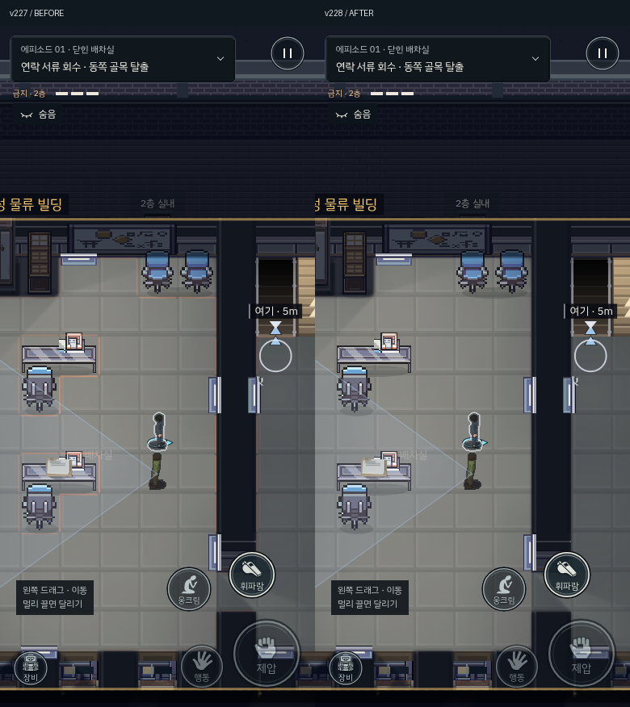
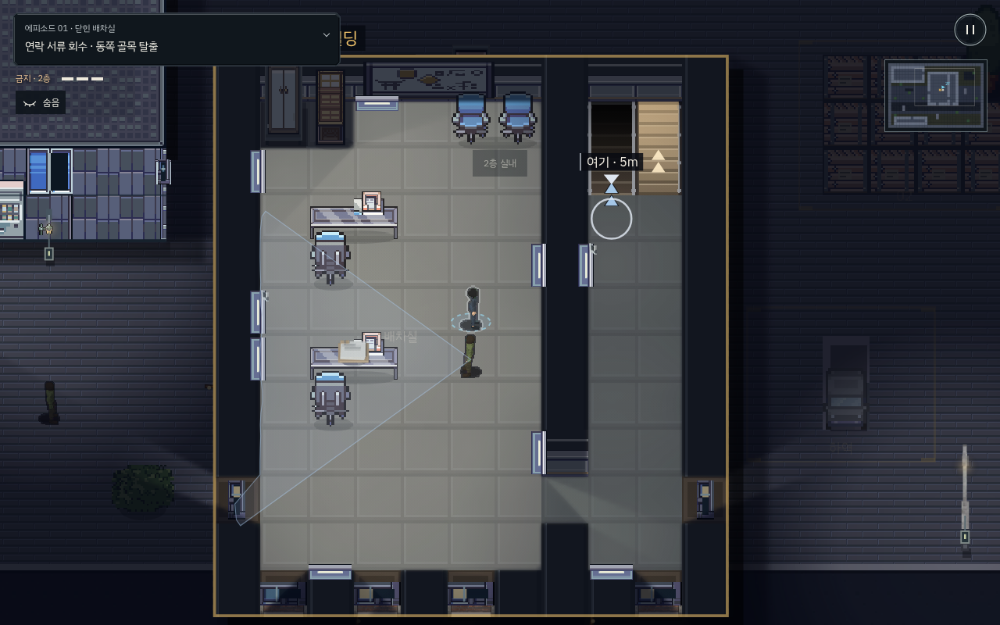

# v228 · 가구 주변의 색 테두리 제거

책상·의자 주변 베이지색 선은 가구 에셋에 포함된 그림이 아니라, 플레이어 근처 통행 불가 타일의 가장자리를 그리던 `drawBlockEdges`의 주황색 선이었다. 인물과의 거리에 따라 농도가 변해 가구에 선택 테두리가 있는 것처럼 보였다.

- 지상·위층·옥상·살피기 모드의 타일 충돌선과 빗금 렌더링을 삭제했다.
- 살피기 모드에서 가구의 물리 칸을 둘러싸던 파란 상자·노란 점선도 삭제했다.
- 원본 가구 그림과 접지 그림자를 사용한다. 실제 문·조명 스위치·서류·수납장 등 상호작용 지점의 안내는 유지한다.
- 통행·시선 차폐·엄폐·높이·상호작용 판정은 변경하지 않았다.

검증: 공개 9개 에피소드의 물리 데이터 해시가 v227과 동일하다. PC·터치 환경에서 1층과 2층, 일반·살피기 모드를 각각 검사해 충돌선·가구 색 상자가 사라지고 상호작용 표시는 남는 것을 확인했다. 동일한 두 사무실의 PC·모바일 전후 화면 8개도 검수했다. 9개 에피소드 실내 아트, 스위치·수납장 검사, 빌드 검사 8개, 물리 상호작용 검사 20개, 패키지 PC·터치 이동·웅크리기·메뉴·일시정지·폰트·12개 파일 해시 검사를 통과했다. 이번 변경에서 미션 전체 완주를 다시 수행한 것으로 주장하지 않는다.

