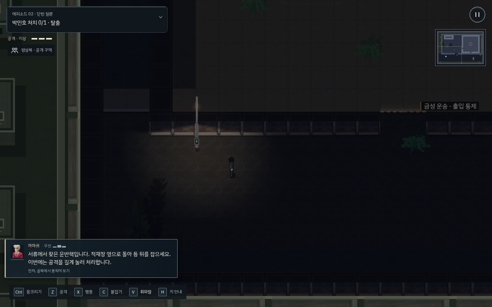
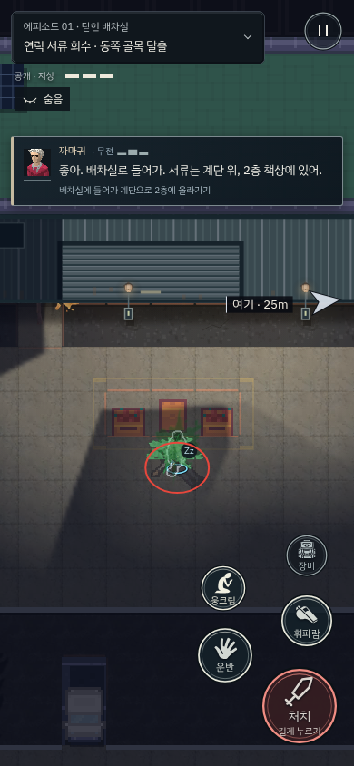

# 의뢰 목표와 현장 무전 분리 · v215

왼쪽 위 목표가 매번 작은 행동으로 바뀌고, 무전도 같은 패널 안에 접혀 현장에서 필요한 지시를 놓치기 쉬웠다. 이제 상단은 최종 의뢰 목표와 완료 수만 유지하고, 다음 행동과 주의점은 별도의 짧은 까마귀 무전으로 전달한다.

## 현장 흐름

- 이동: “오른쪽 골목으로 가. 연락책 제비가 남긴 서류부터 찾자.”
- 접근: “문만 보고 있네. 풀숲에서 나와 조용히 등 뒤로 붙어.”
- 기절/살해 구분: “살려 둬. 공격을 짧게 누르고 떼. 1초 누르면 죽는다.”
- 복장 통행: “통했어. 그냥 걸어가. 계단으로 2층에 올라가면 돼.”
- 조명: “스위치를 내려. 불 켜러 오는 놈을 따로 잡자.”
- 카메라: “걸어갈 땐 괜찮아. 손쓰는 건 찍힌다. 카메라 뒤에서 전선을 끊어.”
- 발각: “들켰어. 모퉁이 돌아! 시야 끊고 숨어. 아직 빠져나갈 수 있어.”

기존 인물·목표·복장·시야·보안 기록·배운 기술과 행동 판정을 읽는다. 컷신이나 새 의뢰 조건을 추가하지 않는다. 까마귀가 안내하는 기존 초반 에피소드와 VIP 구간에 적용하며, 까마귀와 대립하는 후반의 혼잣말 설정을 덮어쓰지 않는다.

## 표시 규칙

무전은 짧은 수신 효과음과 함께 나타나 약 4.7~7초 뒤 접힌다. 동일한 상황을 매 프레임 반복 호출하지 않으며, 필요하면 44px 무전 버튼으로 현재 지시를 다시 볼 수 있다. 수신음은 플레이어 전용 UI 소리로, 적이 듣는 월드 소음을 만들지 않으며 기존 음소거 설정을 따른다. 녹음 음성이나 TTS는 포함하지 않는다.

발각 지시는 일반 작업 안내보다 우선하고, 숨은 뒤에는 달리라는 지시 대신 수색 대기를 안내한다. 근처 표적의 실제 대사 중에는 무전창이 양보한다. 메시지 자체는 목적지·상호작용이나 미션 진행을 변경하지 않는다.

PC와 모바일에서 초상·이름·짧은 대사를 같은 그래파이트/금속 테두리로 표현한다. 무전창과 다시 보기 버튼은 주인공·고정 HUD·문맥 버튼을 피해서 배치한다. 좁은 화면에서는 보조 조작 설명을 생략하고 핵심 대사를 우선한다. 화면은 160ms로 가볍게 정착하며 모션 감소 설정을 따른다. 일반 안내에 화면 흔들림·줌·햅틱을 더하지 않는다.

평소 무전은 게임을 정지시키거나 입력을 가로채지 않는다. 기존 의뢰 패널을 직접 열면 전체 목표·인물/물품 카드와 현재 무전을 읽는 동안 일시정지한다. 접힌 PC 패널의 중복 인물 카드와 예전 중첩 무전 스타일은 통합했다.

## 검증 범위

`tests/rev/t_play_space.py`는 일반 RAF에서 PC/터치 이동, 무전 자동 접힘, 동일 상황 반복 억제, 다시 보기와 계속 흐르는 시간, 의뢰를 열었을 때의 정지/복귀를 검사한다. `t_field_hud.py`는 복장 허용·발각·은신 대기 전환과 무전/문맥 버튼 충돌을 고정 상태에서 검사한다. `t_story_episodes.py`는 각 단계의 대사와 320px 화면·가로 화면 배치를 검사한다. 수동 목표 추적·표적 대사 우선권·체크포인트는 기존 회귀를 유지한다.

`first_steps_live.py`와 `compound_live.py --stage p0`는 알려진 경로를 일반 RAF/AI에서 키보드/CDP 터치 입력으로 수행한다. 배우·체력·시계를 덮어쓰지 않는 개발자 재생이며, 초보자의 이해도나 실제 스마트폰 기기 성능 검증과 구분한다. 캡처에는 현재 기존 소재를 사용했으며 유료 배경팩을 구매하거나 적용하지 않았다.

