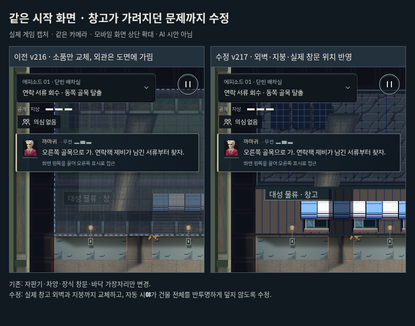

# 무료 소재가 보이지 않던 시작 장면 수정 · v217

v216은 첫 창고의 소품·바닥 가장자리만 교체했다. 더구나 자동 창문 시야가 창고 전체에 내부 도면을 반투명하게 덮어 외관을 가렸다. 같은 시작 위치에서 보면 새 자판기는 화면 밖이고, 외벽과 지붕 대부분은 그대로이거나 가려져 있어 변화를 알아보기 어려웠다.

## 변경

- 공식 무료 City의 벽 패널과 지붕 소재를 더해 총 7개 소재를 사용한다. 첫 잠입과 초반 물류 의뢰(`tB`, `p0`, `p1`, `p2`, `e1`, `e2`)의 지정된 창고 외관에 같은 재질을 적용한다. 중앙 마당의 바닥 패턴을 늘리지는 않는다.
- 원본 비율은 정수 2배로 유지한다. 벽 패널의 장식 가로 띠를 반복하는 시험안과 지붕의 강한 줄무늬 시험안은 제외했다. 벽판의 제한된 부분과 회청색 지붕 질감을 사용하고 기존 처마/옥상 경계와 시설물을 유지한다.
- 자동 창문 관찰이 건물 전체에 도면을 덮던 경로를 제거한다. 실제 시야 다각형과 내부 영역이 겹친 부분만 드러나며, 2칸 높이의 외벽·간판·차양은 그 범위에서 제외한다. 사용자가 살피기 키로 여는 명시적 도면 보기와 실제 감지/빛/충돌 로직은 유지한다.
- 창고의 실제 1층 창문·문 좌표에 프레임과 차양을 배치한다. 그림뿐이던 먼 창문 대신 실제 창문을 보여 주고, 창문 유리·잠금·개방·조명 표현에는 기존 상태 렌더러를 사용한다. 실제 문 개방/잠금과 카드 색도 반영한다.
- 외벽/지붕 캐시는 소재 다운로드가 늦게 끝나도 함께 갱신한다. 물리 칸, 층 높이, 배우 위치, 상호작용 범위와 진행 조건은 바꾸지 않는다.

이 변경은 무료 소재 적용 범위와 외관 가림을 수정한 것이다. 전체 게임의 실내 가구나 모든 장소를 GuttyKreum 소재로 교체한 상태로 취급하지 않는다. 원본 ZIP/전체 타일맵은 비공개이며, 게임의 선별 소재와 사용 조건은 기존 `src/art/gutty-city`에 기록했다. 추가 결제는 없다.

## 검증

- 빌드 파이프라인 8개 통과.
- 외관 소재·창문 시야·지붕 불투명·층 가림·조명 스위치·실내 마감·주인공 동작·누적 의뢰·조작 공간·매달림·옥상 경로·높이 표시·카메라 표현·기존 가독성 관련 14개 회귀 통과.
- 새 픽셀 검사는 시작 위치에서 창문 관찰이 실제로 작동하면서 외벽 위/아래 표면을 덮지 않는지 확인한다. 창문 좌표 3개와 실제 세계 지형은 유지된다.
- 소재 검사는 7개 소재가 실제 캔버스와 캐시 패턴에서 사용되는지, 실제 소등에 반응하는지, 지붕이 불투명한지, 다음 물류 의뢰에도 새 외벽/지붕이 쓰이는지 확인한다.
- 일반 RAF/AI에서 첫 에피소드와 첫 암살 의뢰를 키보드/CDP 터치로 각각 완료했다. 모두 체력 3, 발각 0이다. 알려진 경로의 개발자 재생으로 초보자 이해도나 실제 스마트폰 성능 검증과 구분한다.

아래는 같은 위치·카메라의 실제 렌더링을 고정 캡처하고 상단을 잘라 비교한 화면이다. 원본 모바일 화면과 다음 의뢰 화면도 함께 보관한다.

