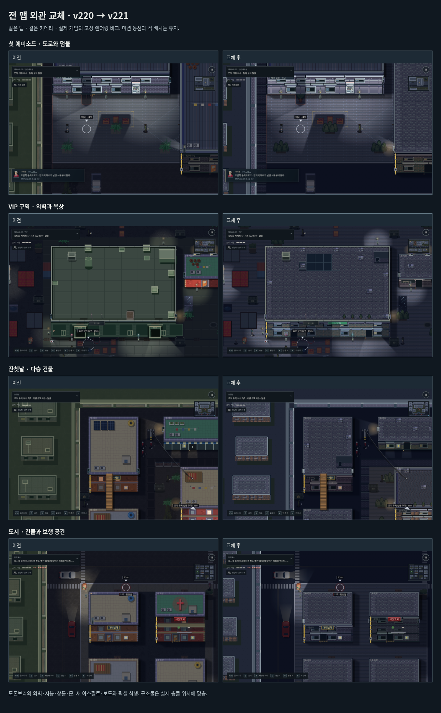
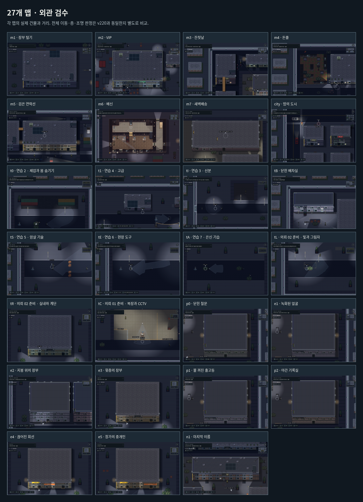

# 전 맵 외관 교체 · v221

일부 물류 건물에만 적용되던 새 외관을 현재 27개 맵 전체로 확장했다. 건물 102동의 지붕, 야외 바닥 20,090칸과 덤불·나무 282곳을 검사했다. 27개에는 선형 캠페인과 기존 연습·도시 맵이 포함된다. 동일한 맵을 재사용하는 에피소드도 각각 검사했다.

## 교체

| 대상 | 새 표현 |
|---|---|
| 외벽 | 창고의 금속 패널, 상가의 녹색 벽돌, 적벽돌·석벽 재질 |
| 지붕 | 골강판, 파형 지붕, 타일 옥상과 테두리 |
| 출입구 | 도톤보리 문짝·문틀과 창틀, 실제 개방·잠금·조명 상태 |
| 도로·보도·야외 바닥 | 새 아스팔트, 포장 벽돌, 흙·잔디 |
| 덤불·나무 | 야간 팔레트의 2D 픽셀 식생, 덤불의 숨기·잎 흔들림 유지 |
| 경계·배경 | 같은 재질의 담장·보도·인접 건물 |
| 옥상 구조물 | 실제 충돌 목록에 맞춘 계단실·설비와 픽셀 실외기·화분 |

기존 3D 건물 그림이 새 외관보다 먼저 그려지던 경로를 우회했다. 기존의 옥상 충돌 목록과 계단실 진입 좌표는 계속 사용한다. 실제 구조물과 관계없는 장식 탱크·계단실의 중복 그림은 새 지붕에서 제거했다. 충돌이 있는 옥상 구조물 61개에는 실제 위치에 그림이 있는지도 검사했다.

닫힌 지붕은 모든 픽셀이 불투명하다. 옆·뒷벽의 창문은 지붕 안쪽에 놓인 실내용 그림 대신 실제 벽 가장자리에 작은 창틀로 표시한다. 실내 가구와 캐릭터는 이 외관 교체의 범위가 아니다.

## 출처와 재현

주 외관은 소유자가 구매한 **GuttyKreum Dotonbori City v3**의 게임용 부분 조합이다. 무료 공식 Free City의 자판기와 **Kenney RPG Urban Pack 1.0 / CC0**의 도로·식생을 보완했다. 식생과 도로는 원래 픽셀 모양을 조합하고 야간 팔레트에 맞췄다. 추가 유료 구매는 없다.

- [도톤보리 사용 범위와 라이선스](../../src/art/dotonbori/LICENSE.txt)
- [Kenney 라이선스](../../src/art/dotonbori/LICENSE-Kenney.txt)
- [선택 영역·조합·원본 해시](../../src/art/dotonbori/exteriors.json)
- [재현용 가져오기 도구](../../tools/import_dotonbori_exteriors.py)

공식 원본 ZIP, 전체 타일맵과 개별 타일 모음은 저장소 밖에 둔다. 게임용 조합 스프라이트 29개를 담은 한 장의 이미지와 메타데이터만 포함한다.

```sh
python tools/import_dotonbori_exteriors.py /private/Dotonbori/Tilemap/MainTileMap.png --urban /private/Kenney-RPG-Urban/Tiles
python build.py
python tools/package_cloudflare_2d.py build/yahaeng_city.html
```

## 검증

- **전 맵 판정 비교:** 동일한 시드로 v220과 v221의 27개 맵을 각각 초기화했다. 층별 격자, 건물 경계·높이, 옥상 장애물과 충돌 칸, 계단·옥상 문 진입점, 조명·적 초기 배치의 해시가 모두 같다. [geometry-comparison.json](geometry-comparison.json)
- **렌더링:** 새 야외 바닥·식생 적용, 모든 지붕의 불투명성, 옥상 장애물의 실제 그림을 검사했다. 전 맵 결과는 [coverage.json](coverage.json)에 기록했다.
- **환경 상태:** PC·세로·가로 화면의 실제 새 그림 제출, 물리 창문 수·위치, 불을 끈 뒤 그림이 어두워지는지, 구매 이미지 로드 실패 시 무료 그림 복구를 검사했다.
- **게임 회귀:** 외관, 창문, 빛, 지붕 가림, 층 분리, 스위치, 실내, 동작, 임무 진행, 옥상 동선, 가장자리, 카메라와 플레이 공간 등 16개 검사 통과. 빌드 검사 8개와 물리 상태 20개 그룹 통과.
- **입력 재생:** 첫 잠입 `tB`, 첫 암살 `p0`, 3층 옥상 미션 `e2`를 PC 키보드와 CDP 터치로 각각 완료했다. 6회 모두 체력 3·발각 0. 옷 갈아입기·몸 숨기기·창문 락픽·계단·옥상 점프·간판 암살·CCTV 전선과 탈출을 실제 입력으로 수행했다. 배우 위치·체력·AI·게임 시간을 덮어쓰지 않는 알려진 경로 재생이다. 초보자 이해도 조사나 물리 iPhone 검증과 구분한다.
- **패키지:** PC·모바일 입력, 메뉴·목표 확인 시 정지/복귀, 폰트와 브라우저 리소스 해시 12개 확인.

`opening-*.json`, `contracts-*.json`은 입력 재생 기록이다. 비교 화면과 외관 목록은 같은 카메라를 사용한 고정 렌더링이며 입력 재생 증거와 구분한다. 전술 지도는 기존대로 실내를 보여 주므로 외관 목록은 일반 화면에서 촬영했다.




